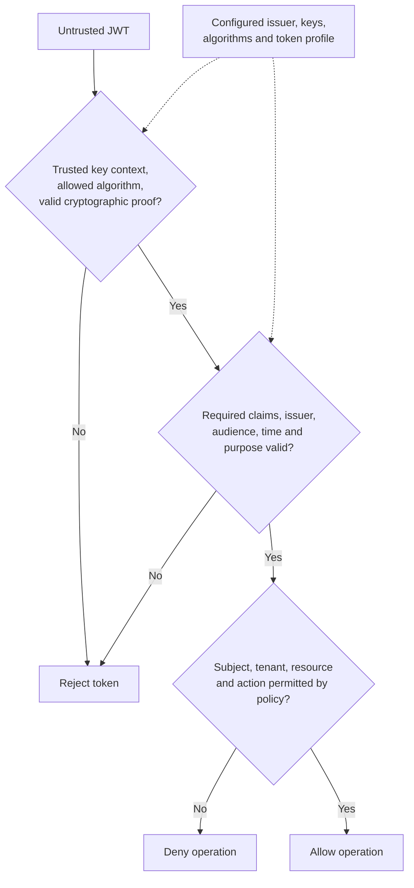

# JSON Web Tokens (JWT)

JWT is a claims representation defined by RFC 7519. It is not a login protocol, an authorization policy, or a guarantee that verification requires no server state. Use maintained JOSE/JWT libraries and a validation policy specific to the token's purpose.

## Structure and Cryptographic Protection

A commonly used signed JWT uses the three-part **JSON Web Signature (JWS) compact serialization**:

```text
base64url(protected-header).base64url(payload).base64url(signature-or-MAC)
```

- **Header:** Identifies the algorithm and possibly a key identifier or token type.
- **Payload:** Contains claims such as issuer, subject, audience, and expiry.
- **Protection:** HMAC uses a shared secret; RSA or ECDSA signatures use a private signing key and public verification key. Neither is accurately described as simply hashing with a key.
- **Confidentiality:** Base64URL is encoding. JWS payloads are readable. JSON Web Encryption (JWE) adds encryption and has a different compact format with five parts.

Do not place passwords or unnecessary personal data in tokens. Encryption requirements depend on confidentiality and intermediary trust; HTTPS is still required for bearer-token transport.

!!! info "External Resources"
    - [JWT Overview](https://www.rfc-editor.org/rfc/rfc7519.html#section-3) (IETF)
    - [Bearer Token Security](https://www.rfc-editor.org/rfc/rfc6750.html#section-5) (IETF)

## Acceptance and Authorization

A valid signature is one check in the acceptance process. Configure the expected issuer, keys, algorithms, audience, and token purpose before processing attacker-controlled input.

1. Select trusted keys through configured issuer metadata or a controlled key distribution mechanism. A `kid` only selects within that trusted context; do not fetch arbitrary URLs supplied in a token.
2. Enforce an explicit algorithm allow-list and compatible key type. Reject unsecured tokens for this authentication use case.
3. Verify cryptographic protection using the library.
4. Require the claims defined by the application's token profile. Check exact issuer, intended audience, expiry, and not-before time when applicable, with bounded clock skew.
5. Distinguish token types and purposes, including ID tokens and API access tokens. Validate the subject in its issuer context.
6. Apply authorization to the resource and action, including tenant membership and current policy. Trusted claims do not automatically grant access.



**Example:** An API expects issuer `https://id.example` and audience `orders-api`. A correctly signed token with `aud: billing-api` must be rejected. Decoding its JSON or successfully verifying its signature cannot change that result.

!!! info "External Resources"
    - [Algorithm, Issuer, Audience, and Token-Type Validation](https://www.rfc-editor.org/info/rfc8725/) (IETF)

## Transport, Replay, and Lifecycle

A bearer token can be reused by whoever possesses it until the server rejects it. Expiry bounds the reuse window; a unique `jti` does not stop reuse unless the application tracks and rejects the relevant reused or revoked identifiers. Ordinary access tokens may intentionally be used for many requests.

| Design decision | Benefit | Tradeoff or required control |
|---|---|---|
| Short-lived access token | Limits exposure and stale claims | Expiry must be checked; repeated use remains possible before expiry |
| Asymmetric signing | Separates signing authority from verification services | Trusted key distribution and rotation are necessary |
| Revocation lookup or introspection | Allows earlier invalidation | Adds state, latency, and availability dependencies |
| Sender-constrained access token | Binds use to proof of a client key | Requires protocol support, such as mTLS or DPoP |
| Refresh token | Obtains replacement access tokens | Protect storage and enforce rotation or sender constraints as required by the client profile |

An application may set an `Authorization: Bearer` header explicitly. A cookie is sent by the browser according to cookie rules; it does not automatically become an Authorization header. HttpOnly cookies reduce direct token extraction through XSS but require CSRF defenses. JavaScript-accessible storage exposes tokens to injected scripts. Prefer a backend-held token design when it fits the application.

!!! info "External Resources"
    - [OAuth Token Replay Prevention](https://www.rfc-editor.org/rfc/rfc9700.html#section-2.2) (IETF)
    - [Session and Browser Storage Considerations](https://cheatsheetseries.owasp.org/cheatsheets/Session_Management_Cheat_Sheet.html) (OWASP)
