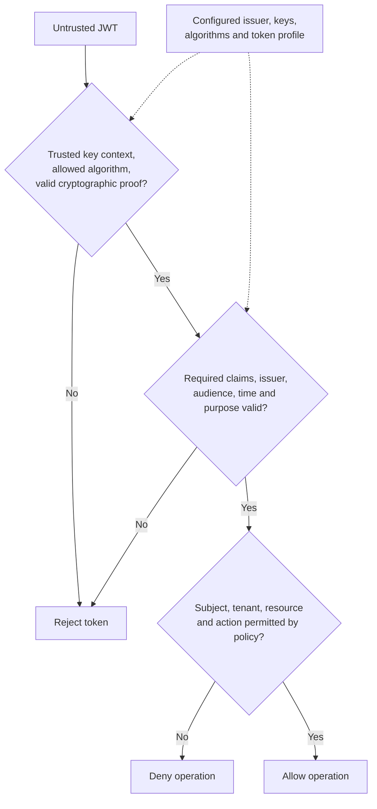

# JSON Web Tokens (JWT)

JWT is a claims representation defined by RFC 7519. It is not a login protocol, an authorization policy, or a guarantee that verification requires no server state. Use maintained JOSE/JWT libraries and a validation policy specific to the token's purpose.

## Structure and Cryptographic Protection

A commonly used signed JWT uses the three-part **JSON Web Signature (JWS) compact serialization**:

```text
base64url(protected-header).base64url(payload).base64url(signature-or-MAC)
```

- **Header:** Identifies the algorithm and possibly a key identifier or token type.
- **Payload:** Contains claims such as issuer, subject, audience, and expiry.
- **Protection:** HMAC uses a shared secret; RSA or ECDSA signatures use a private signing key and public verification key. Neither is accurately described as simply hashing with a key.
- **Confidentiality:** Base64URL is encoding. JWS payloads are readable. JSON Web Encryption (JWE) adds encryption and has a different compact format with five parts.

A decoded header and payload could look like this; these JSON fragments are not a signed token:

```json
{
  "alg": "RS256",
  "kid": "signing-key-2026-10",
  "typ": "at+jwt"
}
```

```json
{
  "iss": "https://id.example",
  "sub": "user-42",
  "aud": "orders-api",
  "iat": 1800000000,
  "exp": 1800000600,
  "scope": "orders.read"
}
```

The issuer signs the encoded header and payload. The API verifies that protection, then checks that this issuer is trusted, the API is the intended audience, time bounds hold, and the token fits its access-token profile. `RS256` describes the claimed algorithm, not permission to choose the verifier's policy. `scope` limits the permission category; the API still authorizes each order. The example uses RFC 9068's access-token type; other token profiles can differ.

Do not place passwords or unnecessary personal data in tokens. Encryption requirements depend on confidentiality and intermediary trust; HTTPS is still required for bearer-token transport.

!!! info "External Resources"
    - [JWT Overview](https://www.rfc-editor.org/rfc/rfc7519.html#section-3) (IETF)
    - [Bearer Token Security](https://www.rfc-editor.org/rfc/rfc6750.html#section-5) (IETF)

## Acceptance and Authorization

A valid signature is one check in the acceptance process. Configure the expected issuer, keys, algorithms, audience, and token purpose before processing attacker-controlled input.

1. Select trusted keys through configured issuer metadata or a controlled key distribution mechanism. A `kid` only selects within that trusted context; do not fetch arbitrary URLs supplied in a token.
2. Enforce an explicit algorithm allow-list and compatible key type. Reject unsecured tokens for this authentication use case.
3. Verify cryptographic protection using the library.
4. Require the claims defined by the application's token profile. Check exact issuer, intended audience, expiry, and not-before time when applicable, with bounded clock skew.
5. Distinguish token types and purposes, including ID tokens and API access tokens. Validate the subject in its issuer context.
6. Apply authorization to the resource and action, including tenant membership and current policy. Trusted claims do not automatically grant access.



**Example:** An API expects issuer `https://id.example` and audience `orders-api`. A correctly signed token with `aud: billing-api` must be rejected. Decoding its JSON or successfully verifying its signature cannot change that result.

!!! info "External Resources"
    - [Algorithm, Issuer, Audience, and Token-Type Validation](https://www.rfc-editor.org/info/rfc8725/) (IETF)

## Trusted Keys and Rotation

A **claim** is a named assertion in the payload, such as `iss` (issuer), `sub` (subject), or `aud` (recipient). A **token profile** specifies how a particular kind of token must be issued and validated. It turns generic JWT syntax into an acceptance contract. For example, RFC 9068 defines an OAuth access-token profile using `typ: at+jwt`; other providers can use different documented profiles. Do not require that type for every JWT, or accept it without the remaining checks. A service token's subject can identify an application rather than a person.

A **JSON Web Key Set (JWKS)** publishes verification keys in JSON. OIDC provider metadata advertises the trusted issuer's `jwks_uri`, along with protocol endpoints. Configure or approve the issuer first, validate its metadata, and obtain keys through that trust relationship. A token's `kid` is a key identifier used to choose among those keys; it is not authority to select a new issuer or arbitrary download location.

**Planned asymmetric-key rotation:**

1. Publish the new public key before issuing tokens signed with its private key. Give consumers time to refresh their key caches.
2. Begin signing new tokens with the new key. Keep the previous public key available while legitimately issued old tokens can still be accepted, including relevant clock tolerance.
3. Retire the previous key after that overlap period. Private signing keys remain at the issuer; APIs need only public verification keys.

On an unknown `kid`, a verifier can perform a bounded refresh from the configured key endpoint, then reject if no trusted matching key is found. Rate-limit and coordinate refreshes so random attacker-selected IDs cannot force unlimited fetches. During an outage, known trusted cached keys may verify appropriate unexpired tokens; an unknown key does not become trusted because the issuer is unavailable.

**Compromise differs from planned rotation:** Publishing a new key does not invalidate tokens signed with the stolen old key. Consumers must stop trusting the affected key or apply another explicit rejection mechanism, with controlled cache invalidation and an incident response plan. Legitimate old tokens may fail too; preserving their availability must not silently preserve the attacker's signing authority.

With HMAC, signing and verification use the same secret. Every verifier that holds it can also mint tokens. Asymmetric verification distributes public keys without distributing signing authority, although recipients must still protect their trust configuration.

!!! info "External Resources"
    - [OIDC Provider Metadata and Signing-Key Rotation](https://openid.net/specs/openid-connect-core-1_0.html#RotateSigKeys) (OpenID Foundation)
    - [Provider Configuration and JWKS URI](https://openid.net/specs/openid-connect-discovery-1_0.html#ProviderMetadata) (OpenID Foundation)
    - [OAuth JWT Access-Token Validation Profile](https://www.rfc-editor.org/rfc/rfc9068.html#section-4) (IETF)

## Time Claims and Token Lifetime

JWT time claims use **NumericDate**: seconds since the Unix epoch, not milliseconds. The token profile decides which claims are mandatory; RFC 7519 does not require every JWT to contain them. An API access-token policy should require expiry rather than silently accepting an unlimited lifetime.

| Claim | Meaning | What it does not establish |
|---|---|---|
| `exp` | Deadline after which the verifier rejects the token | Immediate revocation before that deadline |
| `nbf` | Earliest permitted acceptance time | A guarantee that the token has not been used before |
| `iat` | Time the issuer created the token | When the user last authenticated, or an expiry by itself |

**Example:** `iat=1800000000` and `exp=1800000600` describe a nominal 600-second lifetime. Reusing the token does not move `exp`. The client cannot extend it by editing the payload: the signature would fail. A new token requires a new issuance decision, such as the [OAuth refresh flow](oauth2-oidc.md#refresh-exchange-and-reuse-detection).

**Clock skew** is disagreement between issuer and verifier clocks. A verifier may allow a small configured tolerance around time boundaries. For example, 30 seconds of expiry leeway can allow acceptance until approximately `exp + 30`; include that allowance in exposure and revocation calculations. Synchronize clocks and monitor drift instead of increasing tolerance to hide clock failures. A browser's countdown is a usability aid; the server enforces acceptance.

Expiry limits the life of this credential. It does not automatically end the application's session or prove recent human authentication. See [independent lifetime policies](oauth2-oidc.md#independent-lifetime-policies) and [revocation mechanisms](oauth2-oidc.md#revocation-and-current-authorization).

!!! info "External Resources"
    - [JWT Expiration, Not-Before, and Issued-At Claims](https://www.rfc-editor.org/rfc/rfc7519.html#section-4.1.4) (IETF)

## Transport, Replay, and Lifecycle

A bearer token can be reused by whoever possesses it until the server rejects it. Expiry bounds the reuse window; a unique `jti` does not stop reuse unless the application tracks and rejects the relevant reused or revoked identifiers. Ordinary access tokens may intentionally be used for many requests.

| Design decision | Benefit | Tradeoff or required control |
|---|---|---|
| Short-lived access token | Limits exposure and stale claims | Expiry must be checked; repeated use remains possible before expiry |
| Asymmetric signing | Separates signing authority from verification services | Trusted key distribution and rotation are necessary |
| Revocation lookup or introspection | Allows earlier invalidation | Adds state, latency, and availability dependencies |
| Sender-constrained access token | Binds use to proof of a client key | Requires protocol support, such as mTLS or DPoP |
| Refresh token | Obtains replacement access tokens | Protect storage and enforce rotation or sender constraints as required by the client profile |

An application may set an `Authorization: Bearer` header explicitly. A cookie is sent by the browser according to cookie rules; it does not automatically become an Authorization header. HttpOnly cookies reduce direct token extraction through XSS but require CSRF defenses. JavaScript-accessible storage exposes tokens to injected scripts. Prefer a backend-held token design when it fits the application.

!!! info "External Resources"
    - [OAuth Token Replay Prevention](https://www.rfc-editor.org/rfc/rfc9700.html#section-2.2) (IETF)
    - [Session and Browser Storage Considerations](https://cheatsheetseries.owasp.org/cheatsheets/Session_Management_Cheat_Sheet.html) (OWASP)
