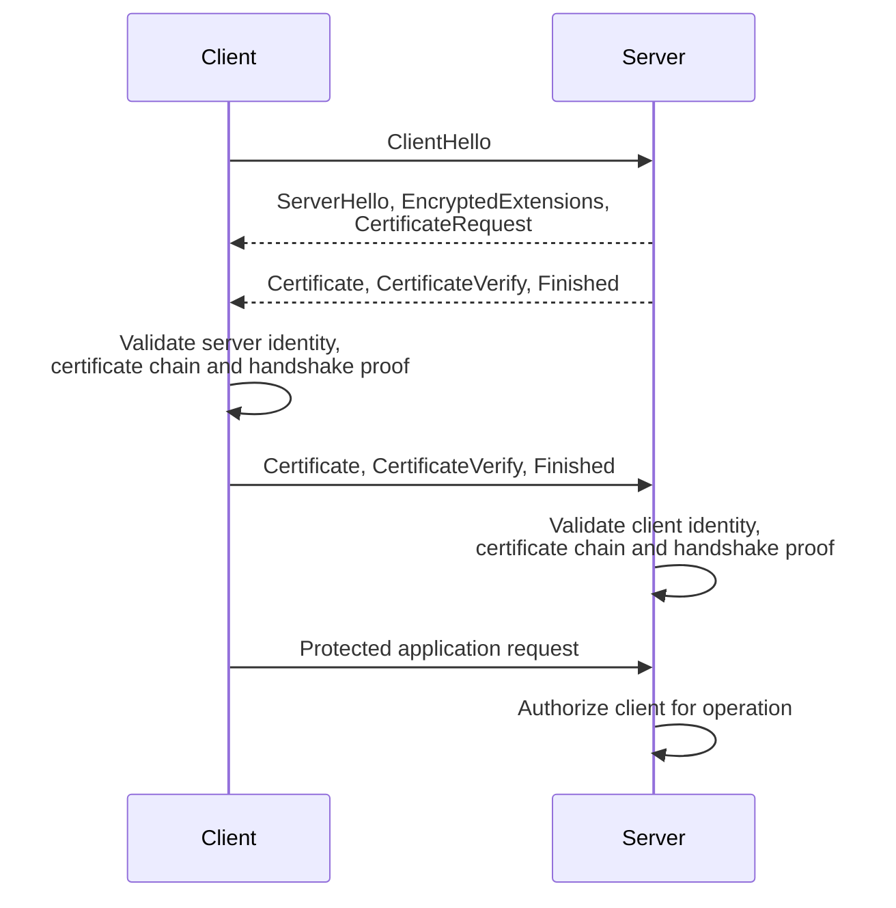

# Mutual TLS (mTLS)

Mutual TLS uses certificate-based authentication for both peers in a TLS connection. It is commonly used for service-to-service communication, device identity, and partner APIs. A trusted certificate proves an authenticated identity only after validation and proof of private-key possession; it does not grant every operation.

## Certificates, Keys, and Trust

A **certificate** binds an identity to a public key and is signed by a **Certificate Authority (CA)**. The peer sends this certificate so the verifier can inspect the identity and validate the CA signature. The matching **private key** remains with the peer and proves that it controls the certified key. Copying a public certificate does not copy that ability.

**Path validation** verifies a chain from the peer certificate through accepted issuing CAs to a configured trust anchor, including applicable constraints and validity. The **Subject Alternative Name (SAN)** identifies names such as a DNS hostname or workload URI. **Extended Key Usage (EKU)** constrains intended uses, such as TLS client authentication. A **trust domain** is an administrative identity namespace and trust policy; sharing it does not grant identical application permissions.

In the handshake, **CertificateVerify** signs connection-specific handshake data with the peer's private key. A recorded signature from a different handshake is not sufficient. **Finished** authenticates the handshake transcript using derived key material, detecting modification of the negotiation. The application then maps the validated peer identity to its permitted operations.

!!! info "External Resources"
    - [TLS CertificateVerify and Finished](https://www.rfc-editor.org/rfc/rfc8446.html#section-4.4.3) (IETF)
    - [Certificate Extensions and Path Validation](https://www.rfc-editor.org/rfc/rfc5280.html) (IETF)

## How it Works

This flow summarizes certificate authentication in TLS 1.3. TLS 1.2 ordering, resumption, and post-handshake authentication differ.

1. The client starts negotiation. The server sends its negotiated parameters and requests a client certificate when mTLS is required.
2. The server sends its certificate chain and a CertificateVerify signature proving possession of the corresponding private key, followed by its Finished message.
3. The client validates the server chain, expected service identity, validity, and applicable key usage/policy, and verifies the handshake proof.
4. The client supplies its certificate and CertificateVerify proof, followed by Finished. The server validates these against its client-identity trust policy.
5. The server maps the verified client identity to an authorization policy for the requested service and operation.

A certificate file by itself is not sufficient to impersonate its owner: the peer must possess the private key. TLS encryption protects the connection, while application authorization still decides resource access.

!!! info "External Resources"
    - [TLS 1.3 Certificate Authentication](https://www.rfc-editor.org/rfc/rfc8446.html#section-4.4) (IETF)

## Identity and Authorization Boundaries

Trust only the issuing authorities and identities needed for the deployment. Check certificate validity, appropriate Extended Key Usage and policy, and the intended peer identity. The server identity may be a DNS name; a workload identity system may use a URI SAN and its own trust-domain rules.

**Example:** Both `orders` and `reporting` have valid certificates from the same organizational CA. An inventory API permits `orders` to update stock and `reporting` to read aggregates. Accepting the `reporting` certificate must not permit stock updates. Trusting a CA is not equivalent to authorizing every identity that CA issues.

If a proxy terminates TLS, downstream services authenticate that proxy connection, not automatically the original client. Strip untrusted identity headers and propagate verified client identity only through an authenticated, explicitly trusted mechanism. Document which component makes the authorization decision.

!!! info "External Resources"
    - [X.509 Certificate and Path Validation](https://www.rfc-editor.org/rfc/rfc5280.html) (IETF)
    - [SPIFFE X.509-SVID Identity and Validation](https://github.com/spiffe/spiffe/blob/main/standards/X509-SVID.md) (SPIFFE)

**Proxy example:** A partner establishes mTLS to a load balancer; the balancer opens a separate mTLS connection to billing using a client certificate that identifies the designated balancer. Billing directly authenticates that balancer on the second connection. To identify the partner, billing must receive identity evidence from the trusted balancer over an authenticated channel, reject caller-injected copies, and enforce that only the designated balancer may assert it. A private network alone does not establish those conditions.

## OAuth Client Authentication and Token Binding

Authenticating a client at the token endpoint proves who requested issuance. It does not automatically protect the resulting token at the API. With an ordinary bearer access token, whoever copies it can present it over their own HTTPS connection.

For an RFC 8705 **certificate-bound token**, the issuer records a binding to the client's certificate. The API validates the token and checks that the certificate authenticated on the API connection matches that binding. A token stolen without the matching private-key capability fails this second check. TLS termination must preserve authenticated certificate evidence for the enforcing component; an arbitrary `X-Client-Cert` header is insufficient.

**DPoP** provides an application-layer alternative. The client signs a proof tied to its key and the HTTP request; the API checks the token's key binding and proof, including method, target URI, freshness, replay controls, and access-token hash as required. It is more than adding a signature header. Both designs limit token-only replay; neither prevents misuse by an attacker who can operate the authorized key/runtime.

!!! info "External Resources"
    - [Certificate-Bound Access Tokens](https://www.rfc-editor.org/rfc/rfc8705.html#section-3) (IETF)
    - [DPoP Resource Access and Proof Validation](https://www.rfc-editor.org/rfc/rfc9449.html#section-7) (IETF)

## Certificate Lifecycle and Failure Handling

| Risk | Primary control | Additional considerations |
|---|---|---|
| Private-key theft | Restrict key access and use protected key storage where supported | Short certificate lifetimes reduce exposure but do not end it immediately |
| Expired credentials | Automate issuance/renewal and monitor expiry | Test rotation overlap and failure recovery before outages |
| Overbroad trust | Restrict trust domains and authorized peer identities | Separate issuing CAs by purpose when appropriate |
| Compromised issuer | Protect CA keys and maintain an incident response process | Plan trust-bundle replacement and workload reissuance |
| Revocation uncertainty | Define how validation responds to revocation information | CRL/OCSP use and availability behavior vary by stack; do not assume every verifier checks them |
| Weak transport settings | Prefer TLS 1.3; support securely configured TLS 1.2 where required | Compatibility policy must be explicit rather than an unqualified version mandate |

A **Certificate Revocation List (CRL)** publishes certificates an issuer has revoked. **Online Certificate Status Protocol (OCSP)** queries status for a certificate. A verifier must actually retrieve/use suitably fresh information for revocation to affect acceptance. If status is unavailable, a fail-open policy may continue accepting a revoked credential; a fail-closed policy can deny legitimate traffic during an outage. Choose and test the deployment's behavior rather than assuming short lifetimes or a CA automatically provide immediate revocation.

mTLS reduces dependence on reusable shared API secrets, but issuance, rotation, authorization mapping, and trust distribution remain operational responsibilities. It is one component of a broader access-control architecture.

!!! info "External Resources"
    - [Transport Layer Security Guidance](https://cheatsheetseries.owasp.org/cheatsheets/Transport_Layer_Security_Cheat_Sheet.html) (OWASP)
    - [Certificate Revocation and Validation](https://www.rfc-editor.org/rfc/rfc5280.html#section-6) (IETF)
