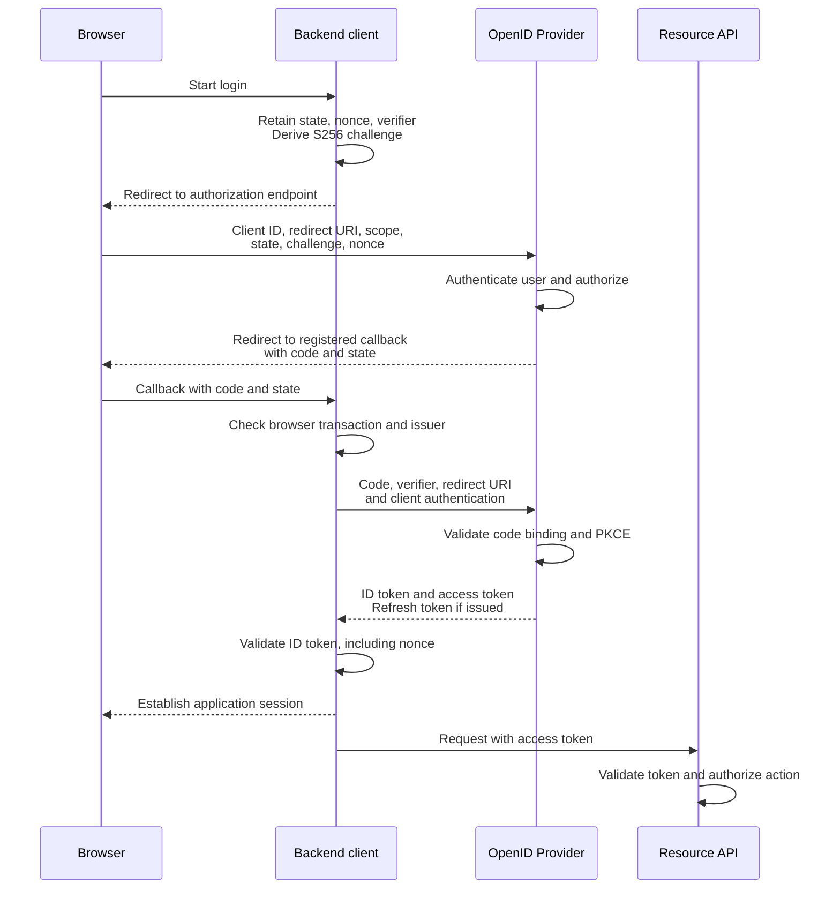

# OAuth 2.0 & OpenID Connect (OIDC)

OAuth 2.0 delegates access to resources. OpenID Connect adds authentication statements for a client. A resource server must not treat an arbitrary OAuth access token as proof of a human login, or accept an ID token in place of its own API access token.

## Roles and Token Purposes

| Role or artifact | Purpose |
|---|---|
| Resource owner | Entity granting access; often a user, absent from a client-credentials interaction |
| Client | Application requesting access; public clients cannot keep a client secret confidential |
| Authorization server / OpenID Provider | Issues access credentials; acts as an identity provider when OIDC is used |
| Resource server | API that validates access credentials and enforces authorization |
| Access token | Intended for a resource server; may be opaque or a JWT |
| ID token | Authentication statement intended for the OIDC client; identifies issuer and subject |
| Refresh token | Credential used at the token endpoint to obtain new access tokens; never an API credential |

OIDC requests include the `openid` scope. Additional scopes such as `profile` and `email` request claims; an ID token need not contain a full user profile. Map local identities by the issuer and subject pair, not an email address alone.

!!! info "External Resources"
    - [OAuth 2.0 Roles and Grants](https://www.rfc-editor.org/rfc/rfc6749.html#section-1) (IETF)
    - [OpenID Connect ID Tokens](https://openid.net/specs/openid-connect-core-1_0.html#IDToken) (OpenID Foundation)

## Endpoints, Grants, and Claims

The **authorization endpoint** is visited through the browser so the provider can authenticate the user and obtain approval. The **token endpoint** receives protocol requests from the client, such as exchanging a code or refreshing credentials. The **resource server** receives access tokens when the client calls an API. Sending a credential to the wrong recipient can disclose it or cause token confusion.

A **grant** is the authorization basis used to request tokens: for example, a user's authorization code or a confidential application's own credentials. A **scope** expresses a requested/issued permission category, such as `invoice.read`; the API still checks the actual invoice and tenant. A **claim** is a token assertion such as issuer, subject, or audience. Scope and identity claims do not replace current application policy.

OIDC can provide profile claims through the **UserInfo endpoint**, which the client calls with a suitable access token. Match the returned `sub` exactly to the subject in the validated ID token before using those claims. Do not infer account ownership by combining unrelated responses merely because their email values match.

!!! info "External Resources"
    - [OIDC UserInfo Response Validation](https://openid.net/specs/openid-connect-core-1_0.html#UserInfoResponse) (OpenID Foundation)

## Authorization Code Flow with PKCE

This flow assumes HTTPS and a pre-registered client and redirect URI. Use an established OAuth/OIDC library for request binding and validation.

1. The client creates transaction-specific `state`, a PKCE verifier, and an OIDC `nonce` when used. Bind them to the initiating browser interaction; derive the S256 challenge from the verifier.
2. The client redirects the browser to the authorization endpoint with client ID, exact redirect URI, scopes, state, challenge, and nonce when used. This **front channel** is visible to the browser.
3. The provider authenticates the user and obtains any required authorization. It redirects back with a short-lived authorization code and state, not an API token in the URL.
4. The client validates the returned transaction binding and issuer context. It exchanges the code and verifier at the token endpoint, using client authentication if it is a confidential client.
5. The provider checks the code, client, redirect URI, and PKCE proof, then issues tokens. This exchange is a **back-channel** server request for a backend client; a SPA performs it from the browser.
6. The OIDC client validates its ID token, then creates an application session if appropriate. The API independently validates the access token and authorizes operations.

The sequence shows a confidential backend client. Redirects cross the browser front channel; code redemption is a direct backend request. Any failed validation stops the flow before session creation or API access.



**Why PKCE works:** The client retains a fresh, unpredictable verifier and sends its S256 challenge, `BASE64URL(SHA256(ASCII(verifier)))`, in the authorization request. The authorization server binds that challenge to the issued code. At redemption, the client supplies the verifier; the server recomputes the challenge and compares it with the stored value. A thief who intercepts only the code and public challenge cannot redeem the code without the verifier; SHA-256 does not make recovery of a suitably random verifier practical. This does not protect a client whose verifier or execution environment is also compromised. An authorization code gives the provider a short-lived, one-time artifact for the browser redirect, while the token endpoint checks its bindings before delivering API credentials. The code is not an API credential and must not be logged as harmless navigation data.

**PKCE policy:** RFC 9700 requires public clients to use PKCE and recommends it for confidential clients. Use S256. PKCE binds the code exchange to the initiating client transaction; it is not client authentication.

**Binding controls:** `state` correlates the response with the browser transaction. `nonce`, when sent, must match the ID token claim. Do not reuse either value across transactions. Libraries can use supported PKCE/nonce-based CSRF defenses under the specification's conditions; do not omit request binding based on an incomplete custom implementation.

**Failure example:** A callback code obtained for another browser transaction must not establish a session. Reject incorrect state/issuer binding, failed PKCE proof, or an incorrect ID token nonce rather than trying a different flow.

!!! info "External Resources"
    - [OAuth Security Best Current Practice](https://www.rfc-editor.org/rfc/rfc9700.html#section-2.1.1) (IETF)
    - [PKCE S256](https://www.rfc-editor.org/rfc/rfc7636.html#section-4) (IETF)

## Validation and Token Lifecycle

- **Redirect URI:** Apply exact matching to registered values, with only the specification's narrowly defined exceptions; prohibit open redirects at the client.
- **ID token:** Validate expected issuer, audience/client ID, signature and algorithm under the library's profile, expiry, and nonce when sent. Apply additional `azp` checks when required. See [JWT validation](jwt.md).
- **Access token:** The API checks intended audience, scope and policy. Use trusted local JWT validation or authorization-server introspection according to the token format.
- **Refresh token:** For public clients, use rotation with reuse detection or sender constraints. Revoke affected token grants when compromise is detected.
- **Transport and logs:** Use HTTPS; avoid credentials in URLs and redact codes and tokens from logs.
- **Provider outages:** New logins and refreshes can fail. Existing application sessions or locally verified access tokens may continue until policy, expiry, or key availability prevents it.

!!! info "External Resources"
    - [OIDC ID Token Validation](https://openid.net/specs/openid-connect-core-1_0.html#IDTokenValidation) (OpenID Foundation)
    - [Refresh Token Protection](https://www.rfc-editor.org/rfc/rfc9700.html#section-4.14) (IETF)

## Refresh Exchange and Reuse Detection

An access token is presented to an API. A refresh token is presented only to the authorization server's token endpoint to request replacement access credentials. Refresh tokens are optional, need not be JWTs, and are not new proof that a person is present. The server decides whether the original grant is still renewable.

1. The client retains the refresh token in protected storage. A backend keeps it server-side; a native app can use an OS credential store. Browser JavaScript storage remains exposed to script compromise.
2. Before access-token expiry, or after a supported expired-token response, the client sends a refresh request over HTTPS. A confidential client also authenticates by its registered method.
3. The authorization server checks the refresh credential, client binding, expiry, revocation, and grant restrictions. Requested scope cannot exceed the original grant; current permissions may further restrict issuance.
4. On success, it issues another access token. If it returns a replacement refresh token, the client securely replaces the previous one. The existing access token's expiry does not change.
5. An expired or revoked refresh grant commonly returns `invalid_grant`. Stop automatic renewal and require a new authorization flow where appropriate; do not loop or fall back to broader credentials. Retry transient service errors separately with bounded backoff.

```http
POST /token HTTP/1.1
Host: id.example
Content-Type: application/x-www-form-urlencoded

grant_type=refresh_token&refresh_token=<refresh-token>&client_id=<public-client-id>
```

An illustrative rotating response issues two new credentials:

```http
HTTP/1.1 200 OK
Content-Type: application/json
Cache-Control: no-store
Pragma: no-cache

{
  "access_token": "<new-access-token>",
  "token_type": "Bearer",
  "expires_in": 300,
  "refresh_token": "<replacement-refresh-token>",
  "scope": "invoice.read"
}
```

Here the access token lasts 300 seconds from response generation. The response does not state the refresh grant's expiry. The client must store the replacement refresh token under the provider's rotation rules; a refresh response is not required to include an ID token.

This illustrates a public client; it does not show confidential-client authentication. Refresh is not another authorization-code redemption and does not reuse the code's PKCE verifier. An OIDC refresh response can omit an ID token. OIDC `offline_access` requests renewal while the user is absent, subject to consent and provider policy; it neither guarantees issuance nor an unlimited lifetime.

**Rotation** replaces a refresh token on use. A **token family** is the server-tracked chain of replacements belonging to the same grant. Suppose `R1` is redeemed for `A2` and `R2`; `R1` is invalidated. Later use of `R1` indicates reuse. The server cannot reliably tell whether the legitimate client or thief used it first, so the RFC 9700 rotation defense revokes the family's active refresh credential, requiring authorization again. Previously issued access tokens require their own invalidation policy.

Two browser tabs or backend workers can accidentally redeem `R1` concurrently. Serialize refresh per grant and coordinate replacement storage. A lost response can also leave the client holding an invalidated token. Use the provider/library's documented recovery behavior; a custom grace period permitting old-token reuse weakens detection and needs explicit bounds. Rotation detects reuse when reuse occurs; it does not prevent a thief from using the first stolen credential.

For public clients, RFC 9700 requires refresh-token rotation or sender constraints. **Sender constraints** require proof of a bound private key, so a copied token alone is insufficient. They do not protect against an attacker able to operate the authorized client and its key.

!!! info "External Resources"
    - [Refreshing an Access Token](https://www.rfc-editor.org/rfc/rfc6749.html#section-6) (IETF)
    - [Refresh Token Rotation and Sender Constraints](https://www.rfc-editor.org/rfc/rfc9700.html#section-4.14) (IETF)
    - [OIDC Offline Access and Refresh Responses](https://openid.net/specs/openid-connect-core-1_0.html#OfflineAccess) (OpenID Foundation)

## Independent Lifetime Policies

**Time to live (TTL)** is the duration a credential or cached result remains acceptable. Several independent clocks exist in an OIDC application:

| Clock | Enforced by | Consequence when it ends |
|---|---|---|
| Access-token lifetime | Resource server, using expiry or introspection | This token no longer authorizes API requests; renewal may still be possible |
| Refresh-token idle timeout | Authorization server | Renewal stops after a configured period without refresh use |
| Refresh-grant absolute lifetime | Authorization server | Renewal stops at the original maximum deadline, even with regular use or rotation |
| ID-token lifetime | OIDC client during validation | An expired token cannot be accepted as a new login assertion; it does not automatically terminate an existing local session |
| Application-session idle/absolute timeout | Application | Browser continuity ends under the application's session policy |
| Authentication freshness | Application/provider policy | A sensitive action may require new human authentication even though tokens and session remain valid |
| Provider SSO session | Identity provider | Controls whether a new authorization interaction can reuse provider login state |

The token response's `expires_in` describes the **access token's** lifetime in seconds; it does not describe refresh-token expiry. Read provider-specific refresh lifetime rules rather than guessing from this field. Activity can reset an idle deadline but must not silently reset an explicitly fixed absolute deadline. Browser refresh-token deployments must enforce a maximum lifetime or inactivity expiry; rotation must not extend a pre-established original expiry under RFC 10017.

**Fresh token versus fresh authentication:** A client can refresh every five minutes for hours without the person signing in again. JWT `iat` records issuance. OIDC `auth_time` records the user's authentication time when supplied. A client can request a recency limit using `max_age` and validate the returned `auth_time`; accepted authentication methods/context still need a separate policy. `acr` can identify an authentication context class, and `amr` can describe methods used; their meanings and trust depend on the provider/profile. Do not assume a particular string establishes phishing resistance. A refresh cannot substitute for an interactive step-up when recent authentication is required.

!!! info "External Resources"
    - [Browser Refresh Token Expiration](https://www.rfc-editor.org/rfc/rfc10017.html#section-6.3.2.3) (IETF)
    - [OIDC Authentication Request Parameters](https://openid.net/specs/openid-connect-core-1_0.html#AuthRequest) (OpenID Foundation)
    - [Session Idle and Absolute Timeouts](https://cheatsheetseries.owasp.org/cheatsheets/Session_Management_Cheat_Sheet.html#automatic-session-expiration) (OWASP)

## Selecting Lifetimes

There is no universal secure TTL. Choose the maximum acceptable misuse/stale-permission window first, then account for token exposure, client storage, renewal load, outage behavior, and user friction. The numbers below are illustrative design exercises, not standards or provider defaults.

| Deployment and assumptions | Example policy to evaluate | Why and remaining risk |
|---|---|---|
| Ordinary business application with backend-held tokens; several minutes of residual API access accepted | 5–15 minute access tokens; refresh grant with 8-hour idle and 24-hour absolute limits | Limits copied access-token exposure while avoiding login on every expiry; refresh theft can sustain access until detected or the grant ends |
| High-impact administration with a 30-second permission-removal requirement | 5-minute access tokens plus a current authorization/revocation mechanism whose total delay is below 30 seconds; interactive reauthentication for sensitive changes | Token expiry alone cannot meet the removal bound; the extra check adds latency and an outage policy |
| Native application with an explicitly approved persistent login | 5–15 minute access tokens; rotating or sender-constrained refresh grant with, for example, 7-day idle and 30-day absolute limits | Reduces repeated login; lost devices and stolen renewable grants need device/grant revocation and secure storage |
| Confidential unattended application with independent authority | Obtain short-lived access tokens through client credentials; evaluate 5–15 minutes against service risk and capacity | Human login/session timers do not apply; protect the application credential that can mint replacements |

For each choice:

1. State which events must stop access: logout, permission removal, account disablement, device loss, or grant expiry. They need not have identical handling.
2. Set an acceptance bound for **already issued tokens**, including verifier clock tolerance and cached decisions. Short access TTLs only help if an attacker cannot keep renewing.
3. Define idle and absolute renewal limits independently. Client credentials normally obtains another access token by authenticating again; a refresh token should not be included in that grant's normal response.
4. Estimate renewal load: 60,000 continuously active grants with five-minute access tokens imply roughly 200 renewals per second before bursts and retries. Refresh slightly early with bounded jitter to avoid synchronized traffic; avoid overlapping refreshes for one grant.
5. Define outage and recovery behavior. Valid local tokens may work until expiry while renewal is unavailable. Do not extend acceptance deadlines or disable validation merely to preserve availability.
6. Test boundary times, stolen copies, refresh reuse, permission changes, and outages. Adjust the policy using measured requirements rather than selecting a number alone.

!!! info "External Resources"
    - [Short-Lived Access Tokens and Replay Risk](https://www.rfc-editor.org/rfc/rfc9700.html#section-4.10) (IETF)
    - [Client Credentials Token Response](https://www.rfc-editor.org/rfc/rfc6749.html#section-4.4.3) (IETF)

## Revocation and Current Authorization

**Revocation** is invalidation before a credential's normal expiry. A locally verified JWT contains a signed snapshot; checking its signature cannot reveal that an administrator role was removed after issuance. APIs need an explicit mechanism to learn about such changes.

| Mechanism | What happens on a request | Where stale acceptance can occur |
|---|---|---|
| Current permission/account lookup | API reads authoritative membership/account policy before allowing the operation | A replica or cached permission may still contain the previous value |
| Token or session revocation lookup | API checks whether the credential ID, grant, or session has been invalidated | Revocation records may take time to reach every region or local cache |
| Token introspection | API authenticates to the authorization server and asks whether a token is active | A cached active result may survive revocation; server semantics determine which account/policy changes affect activity |
| Expiry only | API rejects when the token deadline is reached | Existing tokens remain acceptable for their remaining lifetime, plus permitted skew |

Introspection is a server-to-server status query, not another user login. Its response can report `active: false` for an unusable token, or `active: true` with applicable token metadata. The API still applies resource authorization; an active token does not mean that every object or operation is permitted. Opaque tokens commonly use a lookup/introspection path, and JWTs can also be introspected. Token format alone does not determine revocation capability.

A **positive cache** stores a previous successful result, such as “token active” or “user has administrator permission.” If kept for 60 seconds, requests can reuse it for 60 seconds without checking again. **Replication delay** is the time before a state update reaches another server's copy. **Invalidation delay** is the time before a component discards an obsolete cached result. These delays matter because one API region can still accept authority that another region has removed.

**Worked bound:** Suppose permission removal takes at most 5 seconds to reach the authority queried by each API. An API might fetch the old permission just before that update arrives, then cache it for another 20 seconds. With 2 seconds reserved for processing/timing uncertainty, the design's stated upper bound is 27 seconds for new requests, assuming those maxima are enforced. A 60-second cache would fail a 30-second requirement by itself. For an expiry-only design, include remaining token lifetime and clock leeway instead. Map actual request paths; do not assume all delays are independent or always add every possible timer.

Cache invalidation events can shorten delays, but a guarantee requires handling lost events, disconnected regions, and stale replicas. A privileged operation can reject requests when sufficiently fresh policy is unavailable; lower-risk operations may deliberately accept bounded cached evidence. Document the choice and test it. Also define the boundary for requests already executing or transactions already committed.

**Logout has several scopes:** Clearing the cookie removes that browser's local credential; invalidating the server session prevents other copies of the same session identifier from continuing to work. Revoking a refresh grant stops future renewal under the provider's policy. Outstanding access tokens may remain usable. Ending an IdP SSO session and ending other applications' sessions require separately supported logout mechanisms. Password changes and account disablement do not have uniform automatic effects across providers; verify each credential's behavior.

!!! info "External Resources"
    - [Token Introspection and Caching](https://www.rfc-editor.org/rfc/rfc7662.html#section-4) (IETF)
    - [Token Revocation and Propagation](https://www.rfc-editor.org/rfc/rfc7009.html#section-2.1) (IETF)

## Other Grants and Deployment Choices

**Client credentials** authenticates a confidential client for machine-to-machine access without a user. Restrict its audiences and scopes; its token does not identify a logged-in human.

Avoid implicit access-token delivery. RFC 9700 also prohibits the resource-owner password credentials grant. Native apps and browser apps need client-specific guidance; putting a secret in distributed application code does not make a client confidential.

A backend can retain API tokens and expose an opaque session cookie to the browser. A browser-held access token supports direct API calls but increases exposure to injected JavaScript. Evaluate the trust boundaries, CSRF controls, and recovery requirements rather than prescribing JWTs for every application.

!!! info "External Resources"
    - [Client Credentials Grant](https://www.rfc-editor.org/rfc/rfc6749.html#section-4.4) (IETF)
    - [OAuth Grant Security Recommendations](https://www.rfc-editor.org/rfc/rfc9700.html#section-2) (IETF)
