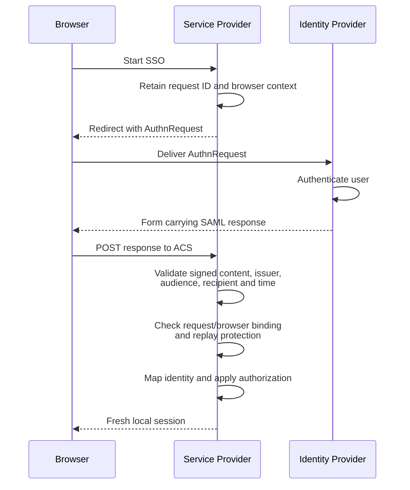

# SAML 2.0 (Security Assertion Markup Language)

SAML 2.0 exchanges XML assertions between an Identity Provider (IdP) and a Service Provider (SP). Browser SSO lets the SP establish a local session without receiving the user's IdP password. Federation trust depends on configured metadata, validation policy, and the exact signed content consumed.

## Assertions and Recipients

An **assertion** is the IdP's statement about a subject and authentication, with conditions restricting acceptance. A **response** is the enclosing protocol message that carries status and one or more assertions. The SP's **Assertion Consumer Service (ACS)** is its endpoint for receiving that response. The SP must consume the exact content its library validated.

A conceptual assertion for one application might state:

| Field | Example | Acceptance question |
|---|---|---|
| Issuer | `https://id.example` | Is this the IdP configured for this tenant? |
| Subject / NameID | `employee-42` | How does this issuer-scoped identifier map to a local account? |
| Audience | `https://billing.example/saml` | Is this the receiving SP's entity ID? |
| Recipient | `https://billing.example/acs` | Is this the expected response-processing endpoint? |
| Expiry | A configured short assertion validity deadline | Is this delivery still timely? |
| InResponseTo | The SP's retained request ID | Does the response belong to this browser's initiated login? |

This is a teaching summary, not deployable XML or a complete validation profile. The **entity ID** identifies the federation participant; the ACS is a destination endpoint, even if both happen to look like URLs. The assertion's delivery validity and the local application's session lifetime are separate.

!!! info "External Resources"
    - [SAML Assertions and Browser SSO Validation](https://cheatsheetseries.owasp.org/cheatsheets/SAML_Security_Cheat_Sheet.html) (OWASP)

## How it Works

In an **SP-initiated** browser SSO flow:

1. The SP creates an authentication request, retains its request ID and browser-transaction context, and redirects the browser to the configured IdP endpoint.
2. The IdP authenticates the user according to policy and creates a response containing an assertion.
3. The browser delivers the response to the SP's Assertion Consumer Service (ACS), commonly through HTTP POST. The response/assertion is protected as required by the selected profile and configuration.
4. The SP's SAML library validates the response and assertion against its trust and request context.
5. The SP maps the validated identity to a local account, applies authorization, and establishes a fresh local session.

**IdP-initiated** SSO has no preceding SP request to correlate. Enable it only deliberately, with profile-specific handling of unsolicited responses, replay protection, and login CSRF risk. Do not accept a missing `InResponseTo` as a fallback for a failed SP-initiated flow.

!!! info "External Resources"
    - [SAML Security and Browser SSO Validation](https://cheatsheetseries.owasp.org/cheatsheets/SAML_Security_Cheat_Sheet.html) (OWASP)

## Assertion Validation

Use a maintained SAML implementation. A valid XML signature alone does not establish that this assertion belongs to this application, request, or user session.

| Check | Required interpretation |
|---|---|
| Trusted issuer and key | Select the expected IdP and keys through trusted metadata/configuration, not arbitrary embedded certificates |
| Signature and algorithms | Enforce accepted signature/digest algorithms and profile-specific signature coverage |
| Exact signed content | Consume only the assertion protected by the validated signature; reject duplicate IDs and wrapping ambiguity |
| Audience | Require the assertion to be intended for this SP's entity ID |
| Destination and recipient | Check the response destination and bearer subject-confirmation recipient against the expected ACS as required by the profile |
| Time conditions | Enforce assertion and subject-confirmation time bounds with small, bounded clock skew |
| Request correlation | For SP-initiated SSO, match `InResponseTo` and the retained browser transaction |
| Replay and status | Reject unsuccessful responses and replayed assertions; retain replay records for the relevant validity period |

**Failure example:** An assertion signed by a trusted IdP for `billing-sp` must not authenticate a user to `support-sp`. Likewise, a valid signed assertion outside the content referenced by the validated signature must not be used.

**Signature-wrapping example:** The library verifies assertion A, which contains the real user and is referenced by the signature. An attacker also supplies unsigned assertion B containing an administrator identity. If application code independently selects “the first assertion,” it may consume B while relying on the library's success for A. Consume the validated result directly and reject ambiguous IDs/structure. Signing some element in the document does not authenticate every other element.

Encryption can protect assertion confidentiality but does not replace signatures, request correlation, or audience validation.

!!! info "External Resources"
    - [SAML Core: Assertions, Conditions, and Signatures](https://docs.oasis-open.org/security/saml/v2.0/saml-core-2.0-os.pdf) (OASIS)
    - [SAML Security Validation Checklist](https://cheatsheetseries.owasp.org/cheatsheets/SAML_Security_Cheat_Sheet.html) (OWASP)

## Bindings, Metadata, and Operational Controls

**Bindings** define message transport, such as HTTP Redirect, POST, and Artifact. Redirect and POST have different encoding/signature rules. POST alone does not prevent open redirects or validate an assertion.

- **RelayState:** Preserve transaction context securely; allow-list any resulting return destination. Do not redirect to arbitrary user-supplied URLs.
- **XML parsing:** Disable external entity resolution and unsafe external resource loading, with limits on document size and complexity.
- **Metadata:** Federation configuration describing entity IDs, endpoints, and signing/encryption keys. Authenticate its source and updates, coordinate certificate rollover, and avoid trusting attacker-supplied endpoints or keys. A certificate embedded in an untrusted response cannot establish the IdP trust relationship.
- **Account mapping:** Scope identifiers to the issuing IdP and configured NameID semantics. Email-like identifiers can change and are not necessarily globally unique or immutable.
- **Local session:** Rotate the session identifier after login and manage local expiry/revocation separately from assertion validity.

SAML is well suited to enterprise browser federation, but XML processing and trust configuration require care. Access tokens for APIs and native client authorization often fit [OAuth/OIDC](oauth2-oidc.md) better.

!!! info "External Resources"
    - [SAML Bindings](https://docs.oasis-open.org/security/saml/v2.0/saml-bindings-2.0-os.pdf) (OASIS)
    - [Session Lifecycle](https://cheatsheetseries.owasp.org/cheatsheets/Session_Management_Cheat_Sheet.html) (OWASP)
