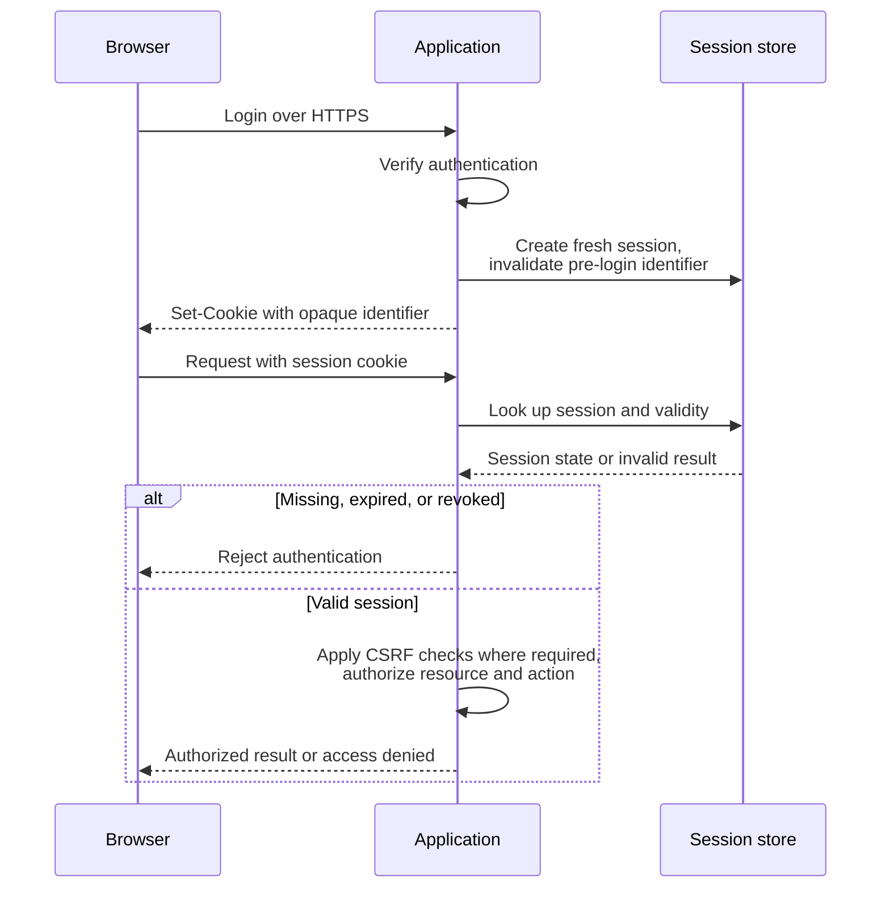

# Session-Based Authentication

A server-side session associates an unpredictable identifier with authenticated state. The browser normally transports that identifier in a cookie. Use a framework's session implementation instead of designing identifiers or cookie cryptography independently.

## How it Works

1. The user submits credentials over HTTPS. The application verifies them and completes any required additional authentication.
2. The server creates a new session identifier using a cryptographically secure random generator. Store identity, creation time, activity time, and authentication strength on the server.
3. The server delivers the identifier through `Set-Cookie`. Rotate any pre-authentication identifier to prevent fixation.
4. The browser sends the cookie only on requests matching its scope and browser policy.
5. The server checks that the session exists, is unexpired and unrevoked, then authorizes the requested action separately.



A conceptual exchange uses a placeholder identifier; production values must be unpredictable and sufficiently long. OWASP recommends at least 64 bits of entropy; framework defaults or at least 128 random bits provide a practical margin for a custom identifier.

```http
HTTP/1.1 200 OK
Set-Cookie: __Host-session=<random-session-id>; Secure; HttpOnly; SameSite=Lax; Path=/
Cache-Control: no-store
```

```http
GET /account HTTP/1.1
Host: app.example
Cookie: __Host-session=<random-session-id>
```

A nonexistent or expired session must fail even if the cookie is otherwise well formed. Never log raw session identifiers.

!!! info "External Resources"
    - [Session ID Properties and Lifecycle](https://cheatsheetseries.owasp.org/cheatsheets/Session_Management_Cheat_Sheet.html) (OWASP)

## Cookie Scope and CSRF

Cookie matching differs from the browser's origin model. Cookies are not isolated by port. Host/domain and path determine delivery scope, while Secure and SameSite add transport and cross-site restrictions. Path is not an access-control boundary between mutually untrusted applications.

| Attribute | Benefit | Limitation |
|---|---|---|
| `Secure` | Restricts delivery to secure transport | Does not prevent endpoint compromise or replace TLS validation |
| `HttpOnly` | Prevents access through `document.cookie` | XSS can still issue authenticated requests and read application data |
| `SameSite=Lax` | Restricts many cross-site cookie sends | Allows top-level navigation using safe methods; never change state through GET |
| `SameSite=Strict` | Excludes cross-site delivery more broadly | Can interrupt legitimate login/navigation flows; same-site is not same-origin |
| `SameSite=None; Secure` | Supports required cross-site delivery | Requires explicit CSRF protection and remains subject to browser privacy policy |
| `__Host-` prefix | Requires Secure, no Domain, and `Path=/` in supporting browsers | Does not bind a cookie to a port |

For cookie-authenticated state changes, use the framework's CSRF protection: a synchronizer token or a signed, session-bound double-submit token, together with appropriate Origin/Referer or Fetch Metadata validation. SameSite is an additional layer. An attacker-controlled sibling subdomain can be same-site while being cross-origin.

!!! info "External Resources"
    - [CSRF Prevention and SameSite Limitations](https://cheatsheetseries.owasp.org/cheatsheets/Cross-Site_Request_Forgery_Prevention_Cheat_Sheet.html) (OWASP)
    - [Cookie Isolation Limits](https://www.rfc-editor.org/rfc/rfc6265.html#section-8.5) (IETF)

### Why CSRF Tokens Help

In **cross-site request forgery (CSRF)**, an attacker causes a browser to submit an unwanted request carrying the victim's automatically attached credentials. Cookie possession tells the server which session made the request; it does not tell the server that trusted application code or the user intended the action.

A **synchronizer token** is an unpredictable value associated with the server session. The application delivers it to its own page and requires it in a form field or explicit request header for state changes. A foreign origin cannot normally read the page to learn this value. The server rejects a missing or mismatched token even if the session cookie is valid.

A **signed, session-bound double-submit token** instead lets the server verify a submitted value against a cookie and a cryptographic binding to the session. Simply checking equality of two attacker-injectable values is insufficient. Use the framework's implementation and protect the signing secret.

For example, `uploads.example.com` and `app.example.com` over HTTPS are different origins but may be the same site. A request initiated by untrusted uploads content may therefore carry the application's SameSite cookie. The application still requires the independent CSRF evidence. Same-origin XSS can often obtain that evidence and send requests; CSRF protection cannot repair script execution inside the trusted application.

!!! info "External Resources"
    - [Synchronizer Tokens and Signed Double-Submit Cookies](https://cheatsheetseries.owasp.org/cheatsheets/Cross-Site_Request_Forgery_Prevention_Cheat_Sheet.html) (OWASP)

## Expiry, Rotation, and Revocation

Enforce expiry on the server; deleting a browser cookie is insufficient to revoke a stolen identifier.

- **Idle timeout:** End the session after a policy-defined period without activity.
- **Absolute timeout:** End the session after its maximum age, even if continuously active.
- **Rotation:** Replace the identifier after login and privilege changes; invalidate the previous identifier. Coordinate concurrent requests through the framework's supported mechanism.
- **Logout and compromise:** Invalidate the server record and clear the cookie with matching scope. Provide account-wide session revocation when required.
- **Sensitive actions:** Require recent or stronger authentication for credential changes, recovery, or high-impact operations.
- **Multiple servers:** Use shared or consistently replicated state, or a documented routing strategy. Revocation latency depends on caches, replicas, and ongoing requests.

**Timeout example:** A session starts at 09:00 with an illustrative 30-minute idle timeout and eight-hour absolute limit. A qualifying request at 09:20 moves the idle deadline to 09:50. No further activity means the next request at 09:51 fails. Continuous activity still cannot extend the session beyond 17:00. Define qualifying activity server-side: automatic polling should not accidentally keep a sensitive session alive forever. A copied cookie can also generate activity, so idle expiry alone does not reliably bound theft.

Cookie `Max-Age`/`Expires` controls browser retention; server-side timeout controls acceptance. Closing a browser or deleting its cookie does not invalidate another copy. See [token and session clocks](oauth2-oidc.md#independent-lifetime-policies) when a session also holds OAuth grants.


**Failure example:** An attacker sets a known pre-login identifier in a victim's browser. If login retains it, the attacker can reuse it. Issuing a fresh identifier and invalidating the old one removes this fixation path; it does not prevent later theft of the new identifier.

!!! info "External Resources"
    - [Session Expiration, Reauthentication, and Logging](https://cheatsheetseries.owasp.org/cheatsheets/Session_Management_Cheat_Sheet.html) (OWASP)
