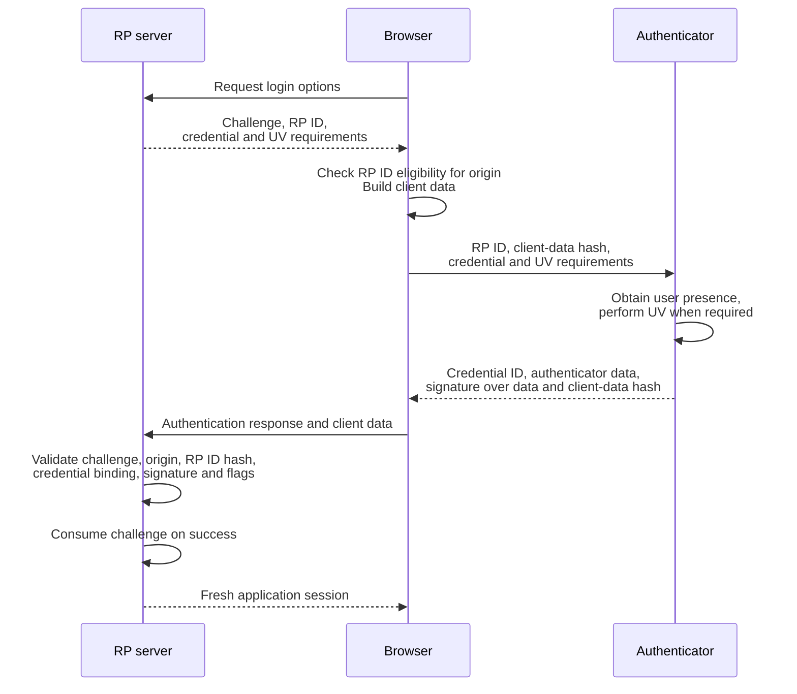

# WebAuthn & FIDO2

WebAuthn is a browser API for registering and using public-key credentials scoped to a relying party (RP). FIDO2 combines WebAuthn with authenticator communication protocols. Passkeys can be device-bound or synchronized across devices; WebAuthn does not require every credential to remain in a hardware security module.

## Credential and Authenticator Types

| Concept | Meaning | Security implication |
|---|---|---|
| Platform authenticator | Integrated with a client platform | May use hardware protection, but properties depend on implementation |
| Roaming authenticator | Separate authenticator, such as a security key | Useful across clients; support for verification methods varies |
| Single-device credential | Not eligible for credential backup | Loss requires another credential or account recovery |
| Multi-device credential | Backup-eligible credential that may be synchronized | Recovery and synchronization provider security become relevant |
| User presence (UP) | Evidence of interaction, such as touching a key | Does not by itself verify the person against a local identity |
| User verification (UV) | Local verification, such as PIN or biometric | RP policy must require it and verify the returned flag when needed |

Private keys are not disclosed to the relying party. A backup-eligible credential can be protected and transferred by its credential provider, so “never leaves the device” is not a universal property. Biometric measurements are not sent to the website as the authentication proof.

!!! info "External Resources"
    - [WebAuthn Credential Backup State and Authenticator Concepts](https://www.w3.org/TR/webauthn-3/#sctn-credential-backup) (W3C)

## Registration and Authentication

Use a maintained WebAuthn server library for registration and response validation.

**Registration:**

1. Establish an appropriately authenticated enrollment or account-creation context. The server generates a fresh challenge and credential creation options.
2. The browser validates RP ID eligibility for the caller's origin and asks an authenticator to create a credential.
3. The authenticator generates the key pair and returns credential data and applicable attestation information.
4. The server verifies the response, challenge, expected origin, RP ID hash, and required flags, plus any chosen attestation policy. It binds the public key and credential ID to the correct account.

**Authentication:**

1. The server creates a fresh, short-lived challenge bound to the login interaction and defines required user verification.
2. The authenticator authorizes use according to its capabilities and policy. It signs authenticator data together with a hash of client data, which contains the challenge, origin, and ceremony type.
3. The server validates the ceremony, expected challenge and origin, RP ID hash, credential/account binding, signature, and required UP/UV flags.
4. Consume the challenge so that the same response cannot establish another login. Create a new application session only after validation succeeds.

For an already registered credential, the authentication ceremony separates browser origin checks, authenticator proof, and server validation. The server holds the credential's public key; the authenticator performs the private-key operation.

**RP ID versus origin:** An RP ID is a domain identifier such as `example.com`, not a scheme/host/port triple. The caller could be `https://login.example.com`; the server still needs an explicit expected-origin policy. Browser checks do not replace server verification. Related-origin features require deliberate configuration and supported implementations.

!!! info "External Resources"
    - [WebAuthn Registration Verification](https://www.w3.org/TR/webauthn-3/#sctn-registering-a-new-credential) (W3C)
    - [WebAuthn Assertion Verification](https://www.w3.org/TR/webauthn-3/#sctn-verifying-assertion) (W3C)

## Threats, Recovery, and Policy

| Scenario | Required reasoning |
|---|---|
| Phishing origin | Credential scoping and expected-origin validation prevent use for an unrelated RP; keep enrollment and recovery equally strong |
| Stolen authenticator | User verification may limit use; a presence-only credential does not guarantee a PIN/biometric gate |
| Replayed response | Match a fresh challenge and consume it; signature verification alone is insufficient |
| Lost device or synchronization account | Support additional credentials and a carefully verified recovery process |
| Attestation | Can inform an authenticator policy; attestation availability and trust must be evaluated, not assumed |
| Signature counter | Use as an implementation-dependent signal; synchronized credentials may not support a simple strictly increasing-counter policy |

**Failure example:** A signature verifies, but the server required UV and the returned UV flag is absent. Reject the login rather than treating the user's touch as equivalent to PIN/biometric verification.

Prefer phishing-resistant authentication for high-value accounts, but manage session theft, XSS, credential enrollment, and recovery separately. A successful WebAuthn ceremony does not prevent misuse of a subsequently stolen session.

!!! info "External Resources"
    - [WebAuthn Security Considerations](https://www.w3.org/TR/webauthn-3/#sctn-security-considerations) (W3C)
