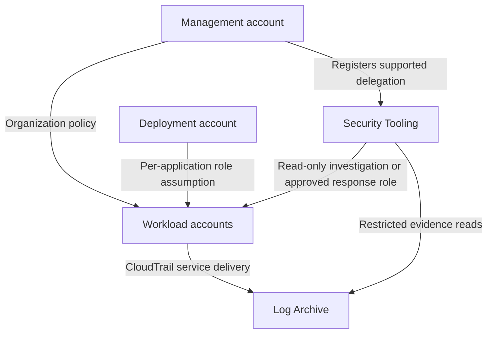

# Multi-Account Security Architecture

This worked design applies [cloud IAM mechanisms](iam.md) to an illustrative AWS organization with 200 accounts. It covers account boundaries, access paths, audit delivery, onboarding, enforcement changes, and emergency operation. Counts, thresholds, and timelines are exercise assumptions, not AWS defaults or a complete reference deployment.

**Study first:** [policy grants and ceilings](iam.md#aws-policy-evaluation-grants-and-permission-ceilings), [cross-account decisions](iam.md#trace-caller-trust-and-target-action), [federation lifecycles](iam.md#federation-claims-issuance-and-outages), and [cloud network segmentation](cloud-security.md#cloud-networking-segmentation).

## Requirements and Threat Model

Assume 40 product teams, a central platform team, and a small security operations team. Teams need independent releases; production data must remain separate from development; the security team needs evidence across every enabled region and account. A compromised developer or workload must not automatically acquire production access or erase the organization's audit history.

The threat model includes stolen workload credentials, a malicious deployment job, excessive third-party access, a mistaken organization policy, an unavailable workforce identity provider (IdP), and failure of the central log pipeline. The management account and central deployment identities are high-impact trust points. Separating accounts reduces some access paths; it does not protect against an organization administrator who can change those paths.

An **account** separates ownership of IAM identities and resources. An **organizational unit (OU)** groups accounts for governance policy. OUs do not create network isolation or grant access. Structure them around different control requirements and lifecycles; keep team ownership in inventory so a team reorganization does not require moving accounts through different security policies.

## Account and OU Boundaries

Keep application workloads out of the management account. Its identities are outside service control policy (SCP) enforcement, so restrict its use to organization operations that require it, protect root recovery, and keep routine deployment credentials elsewhere. Register supported security services with a **delegated administrator** in a member account: the service recognizes that account as an administrator for particular organization features. This is service-specific authority, not automatic permission to administer every resource.

One possible starting allocation is:

| Location | Accounts | Purpose and boundary |
|---|---:|---|
| Management account | 1 | Organization policy, account lifecycle, and required management operations |
| Security OU | 2 | Separate Log Archive and Security Tooling accounts |
| Infrastructure OU | 3 | Network services, shared platform services, and deployment automation |
| Production OU | 80 | Product production workloads separated by required isolation boundaries |
| Nonproduction OU | 100 | Development/test workloads with no standing production trust |
| Sandbox OU | 10 | Experiments with budget controls and no production data |
| Policy Staging OU | 4 | Representative workloads for testing policy changes |
| **Total** | **200** | Account count is illustrative; not one account per employee |

Reserve a quarantine policy path for incidents and onboarding. Moving an account changes policy inheritance; it does not shut down running workloads, revoke every external grant, or retroactively remove data access. A quarantine plan must specify which identity actions and network paths it blocks and which responder and log-delivery paths remain available.



The arrows are authorized access paths, not network routes. Production workloads do not trust every principal in an Infrastructure or Security account. For example, a scanner needing inventory reads should not inherit the incident responder's authority to change network configuration.

**Tradeoff:** More accounts improve independent policy and ownership boundaries but increase account lifecycle, inventory, and deployment work. A central deployment system is convenient but creates a shared compromise path; limit its target roles by application and environment. A central network service reduces duplication but can create common availability and routing failures. Choose boundaries from those consequences, not the number 200 itself.

!!! info "External Resources"
    - [Management-account access and delegated responsibilities](https://docs.aws.amazon.com/organizations/latest/userguide/orgs_best-practices_mgmt-acct.html) (AWS)
    - [Recommended OU and account purposes](https://docs.aws.amazon.com/whitepapers/latest/organizing-your-aws-environment/recommended-ous-and-accounts.html) (AWS)
    - [Security Tooling account responsibilities](https://docs.aws.amazon.com/prescriptive-guidance/latest/security-reference-architecture/security-tooling.html) (AWS)

## Guarded Human and Workload Access

For normal human access, use workforce federation and account-specific roles. A read-only production role can be routinely available; production changes require an approved privilege interval. The access workflow records the actor, requested account, purpose, approver, and expiry before issuing access. Restrict the approval service and its storage: a requester must not be able to edit their own eligibility or approval evidence.

The deployment account holds a narrowly trusted automation identity for each production application. The job exchanges its authorized workload assertion for credentials, then uses only that application's deployment role. The [CI federation design](../authentication/design-patterns.md#6-replace-a-ci-deployment-secret-with-workload-federation) explains the issuer, audience, and workload checks. Nonproduction jobs cannot assume production roles merely because they share the CI platform.

In each target account, separate these capabilities:

| Role purpose | Allowed authority | Protected boundary |
|---|---|---|
| Application deployment | Deploy that application's resources | Cannot alter central audit, responder trust, or its own permission ceiling |
| Inventory collection | Read selected configuration and security state | No routine production data reads or writes |
| Incident response | Approved containment actions | No unrestricted organization or log-archive administration |
| Baseline provisioning | Install reviewed account controls | Stronger change review, narrow trust, separate from application deployment |

A role's name or path does not protect it. Restrict `iam:UpdateAssumeRolePolicy`, policy attachment/version changes, boundary removal, and role deletion for protected roles. A principal that can delete and recreate a protected role, pass it to code it controls, or change its trusted caller can bypass the intended separation. Delegate application-role creation only with an enforced boundary, and protect the boundary policy itself. Review resource policies too, given the [boundary exceptions](iam.md#aws-policy-evaluation-grants-and-permission-ceilings).

A deployment scenario should pass three distinct tests: the approved job can assume its target role; an unrelated job cannot; and the approved role cannot modify its own trust or the account's audit destination. Testing only the second case misses an attacker who compromises the legitimate pipeline.

For a vendor, use a dedicated role with the required permissions and [external ID binding](iam.md#confused-deputy-and-external-id-limits). Review the vendor's data scope, account scope, and expiry. Do not trust an entire internal organization as a substitute for selecting the intended caller role.

!!! info "External Resources"
    - [Delegating IAM administration with boundaries](https://docs.aws.amazon.com/IAM/latest/UserGuide/access_policies_boundaries.html) (AWS)
    - [Role passing and escalation constraints](https://docs.aws.amazon.com/IAM/latest/UserGuide/id_roles_use_passrole.html) (AWS)
    - [Cross-account caller and resource authorization](https://docs.aws.amazon.com/IAM/latest/UserGuide/reference_policies_evaluation-logic-cross-account.html) (AWS)

## Audit Collection and Delivery Failure

**CloudTrail** records supported AWS API activity. Configure an organization trail across enabled regions, choose the management events to collect, and explicitly select required data events, such as reads and writes to sensitive S3 objects. “Organization trail enabled” does not mean every possible data operation is recorded. Select a home region that the intended accounts have enabled and verify new account/region enrollment.

CloudTrail's service delivers to a bucket in the Log Archive account using a resource policy permitting the intended trail. Restrict writes to the required service path and reads to investigation roles. Separate log storage administration from workload administration and from routine Security Tooling access. If logs use a customer-managed AWS Key Management Service (KMS) key, both delivery and authorized reading require the appropriate key access. A usable bucket with an unusable key is not usable evidence.

An organization trail is controlled by authorized management/delegated-administrator operations; ordinary member-account administrators cannot alter it. That restriction does not prevent a central bucket-policy error or an authorized trail administrator from breaking collection. Protect those central changes and detect their consequences.

Use retention controls appropriate to the evidence requirement. S3 Object Lock protects object versions for a configured retention period: governance mode permits specifically authorized bypass, while compliance mode has stricter deletion limits. Protect KMS keys and test recovery as well; retaining encrypted objects does not preserve access if the key becomes unavailable. CloudTrail integrity validation produces signed digests that must actually be verified. It detects changes to delivered evidence; it does not prove that an event excluded by selectors was ever collected.

!!! info "External Resources"
    - [Organization trails, regions, and member-account restrictions](https://docs.aws.amazon.com/awscloudtrail/latest/userguide/creating-trail-organization.html) (AWS)
    - [Log Archive account design](https://docs.aws.amazon.com/prescriptive-guidance/latest/security-reference-architecture/log-archive.html) (AWS)
    - [Object Lock retention modes](https://docs.aws.amazon.com/AmazonS3/latest/userguide/object-lock.html) (AWS)

### Detect Silence as Well as Malicious Events

Maintain an expected inventory of account/region/event-class coverage. A coverage monitor compares that inventory to trail configuration, delivery status, and evidence arriving in storage and the security analysis pipeline. Record collection time and ingestion time separately: a newly ingested old event must not make current coverage look healthy.

In a testable design, a synthetic probe performs an approved, harmless API operation known to be included by the configured selectors, such as a read of a designated test bucket's metadata. Record the successful call's account, region, operation, and time outside the pipeline being tested, then look for the corresponding event. An absent event can mean probe failure, selector error, delivery failure, or ingestion failure; distinguish these before declaring an attack.

For illustration, run a probe every five minutes and investigate when an expected event has not reached the analysis system within twenty minutes. These are local alert targets that must be tuned from observed latency, not a CloudTrail delivery guarantee. Poll trail status independently and alert on delivery errors. The monitor sends its own heartbeat to an alert path outside the ingestion pipeline; otherwise a broken pipeline can also suppress the alarm about its failure.

```text
# Synthetic failure exercise; timings are illustrative.
12:00  Known probe succeeds in production account P, region R.
12:02  Central bucket-policy change removes CloudTrail's delivery permission.
12:05  Next probe succeeds; its event is not observed in the archive.
12:07  Independent status check observes a delivery error and pages the owner.
12:25  Missing-probe deadline also fires; no assumption that "no alerts = no attack".
12:30  Reviewed bucket-policy rollback restores the required service grant.
12:40  Check new arrivals and delayed events; record the gap until reconciled.
```

During investigation, compare raw archive objects with the analysis system. Objects present but unsearchable suggest a downstream ingestion problem; no objects plus a delivery error points toward collection/delivery. Inspect `GetTrailStatus`, bucket and KMS permissions, event selectors, enabled regions, and organization membership. Use independently accessible account event history for applicable management events while restoring the main pipeline, recognizing its scope limits. Preserve evidence of the configuration change and verify delayed delivery; restoration alone does not establish that the gap is complete.

!!! info "External Resources"
    - [Troubleshooting organization trail delivery](https://docs.aws.amazon.com/awscloudtrail/latest/userguide/cloudtrail-troubleshooting.html) (AWS)
    - [GetTrailStatus delivery and error fields](https://docs.aws.amazon.com/awscloudtrail/latest/APIReference/API_GetTrailStatus.html) (AWS)
    - [CloudTrail log integrity guarantees and validation](https://docs.aws.amazon.com/awscloudtrail/latest/userguide/cloudtrail-log-file-validation-intro.html) (AWS)

## Account Onboarding with Infrastructure as Code

**Infrastructure as code (IaC)** stores the intended account configuration in reviewed, versioned definitions. A controller applies those definitions and records the resulting state. Treat account creation and baseline installation as separate stages: a returned account ID does not mean that logging, access, and restrictions are ready.

1. **Register intent.** Record owner, environment, data classification, permitted regions, budget contact, and required access. Reject missing ownership and ambiguous production classification.
2. **Create or enroll.** Put the account on a restricted onboarding policy path. Record its organization membership and recovery ownership. Existing accounts require discovery of current workloads and trust before adoption.
3. **Apply the baseline.** Deploy reviewed role trust, boundaries, audit configuration, security-service enrollment, and monitoring. Organization-wide services can enroll accounts automatically, but verify completion. If using CloudFormation StackSets, constrain who can edit templates and target accounts; the deployment service has extensive authority.
4. **Test effective behavior.** Verify the approved role succeeds, an unapproved caller fails, protected-role mutations fail, and a selected audit probe reaches the archive and analysis system. Configuration presence is insufficient.
5. **Release for workloads.** Move to the intended OU only after checks pass. Recheck inherited controls after the move. Mark partial or failed operations as not ready; retry idempotently and preserve diagnostic state.
6. **Reconcile continuously.** Compare account/region inventory and effective configuration to the baseline. A new account, region, role trust, or changed bucket policy can create drift after onboarding.

Illustrative controller pseudocode; helpers represent the checks described above, not an executable AWS provisioning tool:

```python
# Read intent from a protected, reviewed registry, not requester-controlled claims.
intent = load_approved_account_request(request_id)
require_owner_and_environment(intent)
account = create_or_resume_account(intent)  # Reuse the recorded ID on retry.
apply_onboarding_restrictions(account)
apply_versioned_baseline(account, intent.baseline_version)

# Do not publish "ready" just because deployment jobs reported success.
results = verify_access_and_audit_paths(account)
if not results.all_required_checks_pass:
    record_not_ready(account, results)
    raise OnboardingIncomplete(account.id)
move_to_target_ou(account, intent.ou)
if not verify_inherited_controls(account):
    return_to_onboarding_path(account)
    raise OnboardingIncomplete(account.id)
record_ready(account, intent.baseline_version)
```

A failure after the OU move can briefly expose the account to the target policies. Keep the essential baseline independent of that transition, prevent workload deployment until readiness is published, and verify rollback. Avoid automatically deleting a partially configured account: it may already contain evidence or resources requiring a controlled cleanup.

!!! info "External Resources"
    - [StackSets with service-managed permissions and OU targets](https://docs.aws.amazon.com/AWSCloudFormation/latest/UserGuide/stacksets-orgs-associate-stackset-with-org.html) (AWS)
    - [IAM policy validation with Access Analyzer](https://docs.aws.amazon.com/IAM/latest/UserGuide/access-analyzer-policy-validation.html) (AWS)

## Staged Enforcement and Expiring Exceptions

A new deny can stop an attack path and a necessary production operation at the same time. First define the exact prohibited action, affected principals/resources, and expected legitimate workflows. Inspect historical use to identify dependencies, but do not treat absence from logs as proof that a quarterly recovery task is unnecessary.

Consider a proposal to prohibit application deployers from changing central audit resources. Review policy syntax and access findings, then exercise both permitted deployments and prohibited modifications in Policy Staging. Use representative deployment, backup, incident, and recovery workflows. A policy simulator or linter checks part of the model; it does not establish live service integration behavior.

Roll out to a small set of consenting nonproduction accounts, then a small production cohort, then larger cohorts. Observe access-denied events, release health, audit delivery, and tested response access at each stage. SCPs do not provide a general audit-only enforcement mode: before attachment, estimate impact using recorded activity and tests; after attachment, the policy actually denies matching requests.

Define stop conditions before rollout. For example, an approved deployment fails its acceptance test, audit probes stop arriving, or responders cannot assume their role. Halt expansion and use a narrowly authorized organization-policy operator to restore the previously reviewed attachment or policy version. Test that recovery path before rollout. A member-account administrator cannot override an inherited SCP deny by granting themselves more IAM permissions.

An exception requires an owner, precise scope, rationale, compensating controls, and an enforced expiry. A ticket's expiration field has no effect on AWS until automation changes the actual policy or entitlement. Protect that automation and alert if it cannot reconcile.

```yaml
# Illustrative exception registry, not an AWS policy document.
id: EX-042
account: "444455556666"
owner: payments-platform
control: restrict-legacy-deployment-path
scope: legacy-release-role-only
reason: migrate-release-job-to-approved-federation
approved_until: "2026-11-01T12:00:00Z"
compensating_controls:
  - manual-release-approval
  - alert-on-every-assumption
rollback_owner: cloud-platform-oncall
# Controller removes the exception at expiry, then verifies effective denial.
# Failed reconciliation pages the owner; it does not silently renew approval.
```

A child-account allow cannot cancel a parent SCP deny. Implement the exception in the relevant deny conditions or reviewed policy attachment path, and test that unrelated principals remain denied. Moving an account to an Exceptions OU may remove several inherited protections at once; enumerate those changes before choosing that mechanism. Notify the workload owner ahead of expiry and rehearse closure so the security control does not become an unplanned outage.

!!! info "External Resources"
    - [Testing SCP effects before broad attachment](https://docs.aws.amazon.com/organizations/latest/userguide/orgs_manage_policies_scps.html) (AWS)
    - [SCP inheritance and deny precedence](https://docs.aws.amazon.com/organizations/latest/userguide/orgs_manage_policies_scps_evaluation.html) (AWS)
    - [Access Analyzer policy validation and its findings](https://docs.aws.amazon.com/IAM/latest/UserGuide/access-analyzer-policy-validation.html) (AWS)

## Emergency Access and Containment

Plan separately for an unavailable identity system and a compromised one. An alternate path that still needs the failed IdP, the same device enrollment service, or the same approval system is not independent recovery. For this exercise, pre-provision a small emergency identity path independent of normal federation, with strongly protected authenticators, restricted recovery roles, named custodians, and monitored use. Store recovery instructions where those custodians can reach them during the outage. Root access is reserved for operations and recovery that require it.

This adds standing attack surface. Limit custodians, protect credential and authenticator recovery separately, test availability without granting routine access, and alert on every use. A process requiring two people to authorize retrieval is useful, but is not automatically cryptographic two-person enforcement; state what the credential store and access workflow actually enforce. Prefer a narrower log-repair or organization-policy role over account-wide administration when that can perform the recovery.

For an IdP outage, existing AWS sessions may work until they expire; new issuance may fail. Use emergency access only for the necessary recovery operations, record actions, and review all use afterwards. This plan still depends on reachable AWS endpoints and available IAM/STS control paths. It is not a solution to every regional or provider-wide outage.

For compromise, identify the issuance path and the sessions already created. A possible exercise is:

```text
# Synthetic incident; times describe an exercise, not a response guarantee.
14:00  Authorized production job is compromised; attacker receives role A session.
14:03  A assumes role B through an overly broad downstream trust path.
14:05  Detection identifies unexpected assumption and a sensitive object read.
14:08  Responders block new CI federation and remove the A-to-B assumption path.
14:10  Old A AND B sessions are denied through supported controls; verify both.
14:12  Check actual data access and other role assumptions; preserve audit evidence.
14:30  Rebuild the runner and review workflow changes before restoring issuance.
```

Blocking the CI identity alone leaves AWS sessions outstanding. Revoking A alone leaves B outstanding. A quarantine OU can help constrain member-account roles, but it is not a recursive session revocation mechanism and must preserve the authorized recovery path. Policy changes propagate; test a known old session and keep monitoring for new successful activity rather than equating a submitted change with completed containment.

Record which data or resources the attacker could already reach. Revocation prevents subsequent authorized use once effective; it does not undo downloaded data, created persistence, or destructive operations. Restore normal access only after addressing the compromised workload and reviewing downstream permissions.

!!! info "External Resources"
    - [Emergency access planning and dependencies](https://docs.aws.amazon.com/singlesignon/latest/userguide/emergency-access.html) (AWS)
    - [Disabling temporary-credential permissions](https://docs.aws.amazon.com/IAM/latest/UserGuide/id_credentials_temp_control-access_disable-perms.html) (AWS)
    - [Role-session revocation and propagation caveats](https://docs.aws.amazon.com/IAM/latest/UserGuide/id_roles_use_revoke-sessions.html) (AWS)

## Validation and Operating Measures

Measure behavior against an explicit inventory. “200 accounts enrolled” can hide missing regions, event selectors, broken encryption access, or an untested emergency role. Each check needs an owner, evidence, and a failure action.

| Claim | Distinguishing check | Useful measure |
|---|---|---|
| Production trust is narrow | Approved deployment succeeds; unrelated valid workload fails assumption | Tested trust paths / inventoried required paths |
| Deployers cannot change baseline | Attempt representative protected-role and audit changes in test accounts | Negative tests passing, with policy version recorded |
| All required events are observable | Known probes reach raw storage and the analysis system | Coverage by account/region/event class; end-to-end latency |
| Evidence remains usable | Read/decrypt retained logs and validate selected digests | Last successful restore/validation, unresolved gaps |
| Revocation reaches downstream access | Exercise A-to-B assumption, revoke, then test old credentials for both | Time from containment decision to verified denial |
| Exceptions actually expire | Expire a test exception and verify the previously allowed request fails | Overdue effective exceptions and reconciliation failures |
| Recovery survives IdP failure | Practice using the independent path with normal federation unavailable | Time to perform a scoped repair and completeness of audit |
| Onboarding is complete | New account passes access and audit acceptance before workloads deploy | Accounts ready / accounts expected; oldest incomplete stage |

Do not optimize only for faster denial or fewer findings. Pair security measures with deployment success, recovery time, false alarms, and operator workload. A control that fails silently or is repeatedly bypassed for releases needs design changes. Use the [staff/principal scenarios](../interview-prep/staff-principal.md) to practice defending this design under changed constraints.
