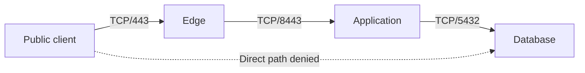

# Segmentation and Firewall Decisions

Segmentation limits which network paths a compromised system can use. A **security zone** groups systems with similar access requirements; an **enforcement point** evaluates traffic crossing a boundary. A VLAN or subnet defines topology. It becomes an access boundary only when relevant paths are constrained by enforced policy.

Prerequisites: [addressing and routing](index.md#routing-switching-fundamentals), TCP/UDP, and [authentication versus authorization](../authentication/index.md).

## From Requirements to Permitted Flows

Start with the caller, destination, direction, protocol, and purpose. Distinguish **north-south** traffic crossing an environment's perimeter from **east-west** traffic between workloads. Internal address space is not evidence that a workload is trusted.

| Source | Destination | New connection permitted | Purpose |
|---|---|---|---|
| Public clients | HTTPS edge | TCP/443; UDP/443 if HTTP/3 is enabled | Public application entry |
| Edge | Application tier | TCP/8443 | Defined backend API |
| Application tier | Database | TCP/5432 | Application data operations |
| Management network | Approved hosts | TCP/22 through controlled access | Administration |
| User workstation | Database | Deny | No direct database access contract |

The database still authenticates its client and enforces data permissions. Permitting TCP/5432 says only that a connection may reach a listener; it does not authorize every SQL operation. Separate production, management, tenant, and recovery paths according to the actual requirements rather than drawing zones with unrestricted `any -> any` rules.



!!! info "External Resources"
    - [Firewall Policy and Architecture — SP 800-41 Rev. 1, 2009](https://csrc.nist.gov/pubs/sp/800/41/r1/final) (NIST; dated architecture guidance)
    - [Zero Trust Architecture — SP 800-207](https://csrc.nist.gov/pubs/sp/800/207/final) (NIST)

## Stateful and Stateless Filtering

A **stateless filter** evaluates each packet against rule fields. A **stateful firewall** also retains flow state. For TCP it can associate a server reply with an allowed client connection. UDP has no handshake, but a firewall can still track address/port tuples and idle timeouts for request/reply traffic. Its concept of an established flow is not proof of a successfully authenticated application session.

```text
App 10.0.20.8:51000 -> DB 10.0.30.9:5432  SYN      # New allowed connection
DB 10.0.30.9:5432 -> App 10.0.20.8:51000  SYN,ACK  # Reply in tracked flow
App -> DB                               ACK      # TCP handshake completes
# A stateless boundary needs rules for both required directions/ports.
# A stateful boundary can allow matching replies without opening all DB egress.
```

**Rule order and state:** In an ordered chain, a terminal decision stops evaluation in that chain; other hooks or policy layers may still apply. An early `established,related accept` rule can retain an existing connection after a later rule blocks new connections. Define whether an emergency policy change must terminate tracked sessions, application sessions, or both. Do not flush all connection state without considering unrelated traffic.

**Asymmetric routing** sends forward and return packets through different devices. A stateful firewall that sees only one direction can reject legitimate replies or report incomplete flows. Troubleshooting must inspect routes and both observation points rather than opening broad ports to hide the problem.

!!! info "External Resources"
    - [nftables Connection Tracking](https://wiki.nftables.org/wiki-nftables/index.php/Matching_connection_tracking_stateful_metainformation) (Netfilter)
    - [Firewall Policy — SP 800-41 Rev. 1](https://csrc.nist.gov/pubs/sp/800/41/r1/final) (NIST)

## Host Input, Forwarding, and NAT

On Linux, traffic delivered to the host traverses an **input** hook; routed traffic traverses **forward**; locally generated traffic traverses **output**. A container bridge/router path can use forwarding even when the application feels local to an operator. Network namespaces provide separate stacks, but veth links, routing, published ports, and host-network mode determine actual reachability.

**NAT** rewrites addresses/ports; it is not an identity or authorization check. **DNAT** can change a public destination to a backend address before a forwarding filter evaluates it. **SNAT/PAT** can make several clients appear under one source address. Determine which original or translated tuple the particular control sees.

```text
Client -> 203.0.113.10:443
PREROUTING DNAT -> 10.0.20.8:8443
Routing decision -> forwarded backend path
FORWARD filter -> evaluate applicable translated tuple / tracked metadata
POSTROUTING -> any applicable source translation
# An INPUT-only deny rule on this gateway does not cover forwarded traffic.
# Return translation depends on connection state and the actual route.
```

A host-bound service listening on `127.0.0.1` normally accepts local IPv4 connections only. `0.0.0.0` listens on all local IPv4 interfaces; `::` is IPv6 wildcard and dual-stack behavior varies by socket settings. A proxy, port publication, or tunnel can expose an otherwise local service. Check listeners, routes, translation, firewall rules, and upstream ingress together.

!!! info "External Resources"
    - [nftables Hooks and Packet Flow](https://wiki.nftables.org/wiki-nftables/index.php/Netfilter_hooks) (Netfilter)
    - [NAT Chains and Bindings](https://wiki.nftables.org/wiki-nftables/index.php/Performing_Network_Address_Translation_%28NAT%29) (Netfilter)
    - [Network Namespaces](https://man7.org/linux/man-pages/man7/network_namespaces.7.html) (Linux man-pages)

## Worked Host Ruleset

This nftables example assumes a standalone Linux HTTPS host with an existing table name free for use. It permits SSH only from a documentation management subnet, HTTPS over TCP, loopback, and required diagnostic/control traffic. It denies forwarding and leaves output unrestricted. It is not a router/container-host ruleset or an egress-control design. Do not load it over a remote session without validating management reachability and a recovery path.

```nft
# /tmp/study-host.nft — illustrative policy; adapt interfaces and addresses.
table inet study_host {
    chain input {
        type filter hook input priority 0; policy drop;
        iifname "lo" accept
        ct state invalid drop
        ct state established,related accept
        # IPv4 errors needed for diagnosis and path-MTU handling.
        ip protocol icmp icmp type { destination-unreachable, time-exceeded, parameter-problem } accept
        # Permit IPv6 control traffic here; refine by role under RFC 4890.
        meta l4proto ipv6-icmp accept
        ip saddr 192.0.2.0/24 tcp dport 22 ct state new accept
        tcp dport 443 ct state new accept
        # Logging is an observation action; explicit drop is separate.
        limit rate 5/second log prefix "study-input-deny: "
        counter drop
    }
    chain forward {
        type filter hook forward priority 0; policy drop;
    }
}
```

```bash
# On an isolated Linux lab host with nftables installed:
sudo nft -c -f /tmp/study-host.nft  # Check against current kernel/config; do not apply.
sudo nft list ruleset             # Inspect all tables, not just this example.
# Loading a table with an existing name or conflicting hooks requires review.
# No flush ruleset is used: this lesson must not erase unrelated firewall policy.
```

The `inet` family covers IPv4 and IPv6, but an `ip saddr` condition matches IPv4 only. This policy intentionally does not grant IPv6 SSH administration. Test the intended IPv6 management policy separately. Allowing all ICMPv6 is an explicit teaching simplification; indiscriminate ICMPv6 blocking can break neighbor discovery and path MTU. Log rate limits constrain log generation, not the number of packets denied by the following drop.

!!! info "External Resources"
    - [nftables Server Ruleset](https://wiki.nftables.org/wiki-nftables/index.php/Simple_ruleset_for_a_server) (Netfilter)
    - [ICMPv6 Filtering Recommendations](https://www.rfc-editor.org/rfc/rfc4890.html) (IETF)

## IPv6 and Local-Link Controls

IPv6 hosts learn neighbors through **Neighbor Discovery (NDP)** and routers through **Router Advertisements (RA)** rather than IPv4 ARP. An IPv4-only filter, ARP inspection rule, or NAT assumption does not cover these mechanisms. Match the deployment's IPv6 forwarding and endpoint policy; use switch features such as RA Guard with attention to fragmentation/extension-header handling.

A VLAN limits ordinary Layer-2 broadcasts but does not stop routing permitted between VLANs. DHCP snooping constrains server messages and builds address/port bindings; Dynamic ARP Inspection checks IPv4 ARP against trusted bindings or explicit policy. Static-address devices need appropriate bindings. 802.1X authenticates admission to the network; it does not automatically authorize every admitted host to every service.

!!! info "External Resources"
    - [IPv6 Neighbor Discovery](https://www.rfc-editor.org/rfc/rfc4861.html) (IETF)
    - [RA Guard Implementation Advice](https://www.rfc-editor.org/rfc/rfc7113.html) (IETF)

## Change, Outage, and Verification

A rule rollout is not complete when one configuration file changes. Account for policy distribution, controller failures, active flow state, failover devices, and alternate paths. **Fail-open** preserves traffic when a control fails; **fail-closed** denies traffic without a usable decision. Choose per risk and availability requirements rather than assuming either has no operational cost.

For example, a new-connection deny propagated in 10 seconds can still leave a database connection accepted by existing-flow rules. A requirement to stop all access in 30 seconds must include state/session termination and enforcement in every path. Network removal also cannot undo a transaction already committed.

Use a small expected-flow matrix: permitted path, denied sibling path, direct bypass, existing connection after change, IPv4, IPv6, failover, and outage. Observe rule counters and endpoint responses. A scan reporting “filtered” is evidence from one vantage point; it is not proof of universal isolation. See [measurement limits](security-tools.md#interpret-results-before-changing-policy) and [interview exercises](interview-questions.md).

## Cloud Security Groups and Subnet ACLs

Cloud controls have provider-specific semantics; do not translate one product's rule behavior into another's by name alone. In AWS, **security groups** supply stateful allow rules at associated resources/interfaces. Matching replies to allowed traffic do not need a separate reverse security-group allow. **Network ACLs (NACLs)** filter traffic entering/leaving a subnet with ordered allow/deny rules and no connection tracking. They therefore need appropriate return-path rules too. A valid security-group decision does not bypass a denying NACL, route, host filter, or application check.

```text
Client 10.0.1.8:51000 -> DB 10.0.2.9:5432/TCP
DB-subnet NACL ingress: allow client subnet to destination port 5432
DB-subnet NACL egress:  allow destination client subnet/port 51000 for this reply
# Production rule ranges follow actual client ephemeral ranges and requirements.
# Other subnet boundaries, routes, security groups, and host checks still apply.
```

Security groups aggregate their allow rules; adding a narrower group does not cancel a broader group's allow. A private subnet or NAT gateway is not permission to reach every service. Conversely, a private endpoint supplies a network path to a cloud service, not automatically authorization for all its resources. IAM, resource/endpoint policies, and the identity actually used by the SDK still matter. Diagnose network reachability separately from service authorization failures.

!!! info "External Resources"
    - [AWS Security Group State and Rules](https://docs.aws.amazon.com/vpc/latest/userguide/vpc-security-groups.html) (AWS)
    - [AWS Network ACL Ordering and Return Traffic](https://docs.aws.amazon.com/vpc/latest/userguide/vpc-network-acls.html) (AWS)

## Instance Metadata and Workload Identity

AWS EC2's **Instance Metadata Service (IMDS)** is a local service that can supply instance metadata and, when configured, instance-role credentials. An SSRF flaw or compromised workload can be dangerous if it can reach a more privileged instance role. AWS security groups and NACLs do not filter IMDS traffic; use supported instance options and host/workload controls rather than assuming an Internet-egress deny protects it.

**IMDSv2** requires a session token acquired with an HTTP PUT before metadata requests. Requiring it mitigates classes of SSRF that cannot perform the token exchange, but does not stop every arbitrary-request SSRF or a compromised process able to perform that exchange. The token is a metadata-session credential, not a narrowly scoped IAM permission for a particular application.

The configured **PUT response hop limit** affects how far the token response can travel. A value of one can prevent response delivery through an extra routed container hop, but can also break a workload that depends on that path. Host-networked workloads do not necessarily introduce that hop. Choose and test the actual architecture; do not treat one hop-limit value as universal pod isolation. Account for the IPv6 IMDS endpoint too when enabled.

**IAM roles for service accounts (IRSA)** lets a pod's supported SDK obtain AWS role credentials using its Kubernetes service-account identity rather than relying on the node role. For EKS, assign supported per-workload identities (such as IRSA or EKS Pod Identity) and least-privilege roles, minimize node-role privileges, and restrict unintended node-metadata access. Configuring a pod's intended identity does not by itself remove other reachable credential sources. SDK credential selection and hostNetwork/node privileges remain relevant. Never use live role credentials as a demonstration fixture.

!!! info "External Resources"
    - [IMDSv2 Behavior and Token Exchange](https://docs.aws.amazon.com/AWSEC2/latest/UserGuide/configuring-instance-metadata-service.html) (AWS)
    - [Limit IMDS Access](https://docs.aws.amazon.com/AWSEC2/latest/UserGuide/instance-metadata-limiting-access.html) (AWS)
    - [EKS Workload Credential Isolation](https://docs.aws.amazon.com/eks/latest/userguide/iam-roles-for-service-accounts.html) (AWS)

## Kubernetes NetworkPolicy Enforcement

A Kubernetes **namespace** scopes API objects; it is not automatically a packet filter. A **NetworkPolicy** declares permitted pod traffic, but enforcement requires a network implementation that supports it. The Container Network Interface (CNI) plugin integrates pod networking; check the actual dataplane's policy capabilities. The API server accepting a policy does not prove that packets are being filtered.

For the standard `networking.k8s.io/v1` API:

- A policy's `podSelector` selects target pods in that policy's namespace. A direction becomes isolated when an applicable policy selects that pod for Ingress or Egress. Otherwise that direction is normally non-isolated under standard NetworkPolicy; other platform controls can still restrict it.
- Applicable allow rules are additive. An empty default-deny policy establishes isolation; a later allow-all policy can permit traffic again. There is no ordered deny-overrides rule in this API.
- For a pod-to-pod connection, the source's egress and destination's ingress must both permit it if those directions are isolated. Reply traffic for permitted connections is implicitly allowed.
- One peer containing `namespaceSelector` and `podSelector` requires both to match. Two peer list items are alternatives: either can match. A lone `podSelector` peer selects pods in the policy's own namespace.
- Standard policy targets pod/network L3/L4 relationships, not DNS domain allow-lists, HTTP paths, or verified service-account identity. Labels select objects; their safety depends on who may create/relabel those objects and alter policy.

```yaml
# Complete minimal object; assumes the network plugin enforces NetworkPolicy.
apiVersion: networking.k8s.io/v1
kind: NetworkPolicy
metadata:
  name: isolate-both-directions
  namespace: payments
spec:
  podSelector: {}  # All pods in payments; other namespaces need their own policy.
  policyTypes: [Ingress, Egress]
  ingress: []     # No allowed new ingress under this policy.
  egress: []      # No allowed new egress under this policy.
# Other policies selecting these pods can add permits; this is not an overriding deny.
```

Observe both allowed and denied new connections, cross-node and same-node paths, relevant IP families, and policy rollout. Existing-flow termination, Service/NAT ordering, and hostNetwork/node traffic handling depend on the implementation; do not infer them solely from a YAML object. Restrict privileged/hostNetwork workloads separately.

!!! info "External Resources"
    - [NetworkPolicy Selection, Additivity, and Implementation Limits](https://kubernetes.io/docs/concepts/services-networking/network-policies/) (Kubernetes)

### DNS Under Egress Isolation

An egress-isolated application often needs an explicit resolver path before it can locate permitted dependencies. Allow the actual resolver destination and required DNS transports; classic cluster DNS can use both UDP/53 and TCP/53. An allow for DNS does not authorize a later database/HTTPS connection, which needs its own permitted destination/port.

CoreDNS may run behind a Service, while NodeLocal DNSCache can expose a node-local address. Inspect the pod's resolver configuration and the plugin's Service-translation/host-network behavior before choosing selectors or an `ipBlock`. Allowing CoreDNS pods by labels may not describe a NodeLocal path. Standard NetworkPolicy cannot express “allow HTTPS only to whatever name this DNS query returns.” Use supported additional egress/FQDN controls or a deliberately constrained proxy when that is the requirement. Resolver access also retains the [DNS exfiltration risks](dns.md#data-exfiltration-and-resolver-policy).

!!! info "External Resources"
    - [DNS for Services and Pods](https://kubernetes.io/docs/concepts/services-networking/dns-pod-service/) (Kubernetes)
    - [NodeLocal DNSCache Paths](https://kubernetes.io/docs/tasks/administer-cluster/nodelocaldns/) (Kubernetes)

## Mesh Identity and Traffic Entry Points

In a service mesh, authenticated encryption establishes a protected connection and peer identity. It does not by itself decide which identity may call which application. For example, in a covered Istio sidecar deployment, **PeerAuthentication STRICT** requires accepted peer traffic to use mTLS, while an **AuthorizationPolicy** can restrict the authenticated workload principals, ports, and supported application operations. An unexpected workload can have a valid mesh certificate and still need to be denied. With no applicable ALLOW policy, STRICT alone adds no caller allow-list. When ALLOW policies apply, a request must match at least one applicable allow, subject to Istio's CUSTOM and DENY evaluation; an additional broad ALLOW can widen the permitted set. Explicitly verify workload enrollment, intercepted paths, policy attachment, and excluded ports; sidecar configuration is not a universal rule for ambient mode or every mesh.

NetworkPolicy can constrain network reachability alongside mesh policy. The application still validates user/tenant/object authority where a service acts for a person. A trusted workload certificate is not evidence that every end user is entitled to a requested invoice.

A Kubernetes **Service** supplies a stable forwarding abstraction; **NodePort** and **LoadBalancer** can expose additional entry paths. An **Ingress** or **Gateway API** resource expresses routing configuration that a compatible controller implements. Installing it does not automatically remove an existing public Service or node-port path. A WAF, login check, rate limit, or TLS policy at one gateway can be bypassed if traffic can reach the backend through another accepted path.

```text
Intended: client -> public gateway/WAF -> internal Service -> application
Bypass:   client -> old LoadBalancer address ----------------> application
# Deleting the old DNS name does not remove its still-reachable listener.
```

Inventory Services, gateway/controller listeners, cloud load balancers, routes, node exposure, and backend controls. Kubernetes/cloud-controller behavior, source-IP preservation, SNAT, and trusted forwarded headers affect which identity/address each enforcement point sees. `externalTrafficPolicy: Local` is not an authentication policy and does not make caller-supplied forwarding headers trusted. For example, the designated gateway strips/rebuilds forwarded identity/address headers from its validated connection context, and the backend accepts them only through its configured trusted proxy path. A direct caller must not be able to claim another source simply by supplying `X-Forwarded-For`; trusted-chain parsing must not treat a caller-controlled leftmost value as verified identity. Remove or restrict alternate paths under the intended contract and validate backend authorization independently.

!!! info "External Resources"
    - [Istio Peer Authentication](https://istio.io/latest/docs/reference/config/security/peer_authentication/) (Istio)
    - [Istio Authorization Policy](https://istio.io/latest/docs/reference/config/security/authorization-policy/) (Istio)
    - [Kubernetes Service Exposure](https://kubernetes.io/docs/concepts/services-networking/service/) (Kubernetes)
