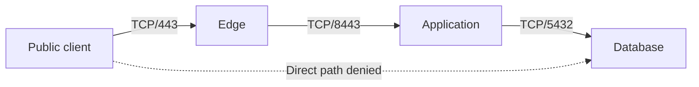

# Segmentation and Firewall Decisions

Segmentation limits which network paths a compromised system can use. A **security zone** groups systems with similar access requirements; an **enforcement point** evaluates traffic crossing a boundary. A VLAN or subnet defines topology. It becomes an access boundary only when relevant paths are constrained by enforced policy.

Prerequisites: [addressing and routing](index.md#routing-switching-fundamentals), TCP/UDP, and [authentication versus authorization](../authentication/index.md).

## From Requirements to Permitted Flows

Start with the caller, destination, direction, protocol, and purpose. Distinguish **north-south** traffic crossing an environment's perimeter from **east-west** traffic between workloads. Internal address space is not evidence that a workload is trusted.

| Source | Destination | New connection permitted | Purpose |
|---|---|---|---|
| Public clients | HTTPS edge | TCP/443; UDP/443 if HTTP/3 is enabled | Public application entry |
| Edge | Application tier | TCP/8443 | Defined backend API |
| Application tier | Database | TCP/5432 | Application data operations |
| Management network | Approved hosts | TCP/22 through controlled access | Administration |
| User workstation | Database | Deny | No direct database access contract |

The database still authenticates its client and enforces data permissions. Permitting TCP/5432 says only that a connection may reach a listener; it does not authorize every SQL operation. Separate production, management, tenant, and recovery paths according to the actual requirements rather than drawing zones with unrestricted `any -> any` rules.



!!! info "External Resources"
    - [Firewall Policy and Architecture — SP 800-41 Rev. 1, 2009](https://csrc.nist.gov/pubs/sp/800/41/r1/final) (NIST; dated architecture guidance)
    - [Zero Trust Architecture — SP 800-207](https://csrc.nist.gov/pubs/sp/800/207/final) (NIST)

## Stateful and Stateless Filtering

A **stateless filter** evaluates each packet against rule fields. A **stateful firewall** also retains flow state. For TCP it can associate a server reply with an allowed client connection. UDP has no handshake, but a firewall can still track address/port tuples and idle timeouts for request/reply traffic. Its concept of an established flow is not proof of a successfully authenticated application session.

```text
App 10.0.20.8:51000 -> DB 10.0.30.9:5432  SYN      # New allowed connection
DB 10.0.30.9:5432 -> App 10.0.20.8:51000  SYN,ACK  # Reply in tracked flow
App -> DB                               ACK      # TCP handshake completes
# A stateless boundary needs rules for both required directions/ports.
# A stateful boundary can allow matching replies without opening all DB egress.
```

**Rule order and state:** In an ordered chain, a terminal decision stops evaluation in that chain; other hooks or policy layers may still apply. An early `established,related accept` rule can retain an existing connection after a later rule blocks new connections. Define whether an emergency policy change must terminate tracked sessions, application sessions, or both. Do not flush all connection state without considering unrelated traffic.

**Asymmetric routing** sends forward and return packets through different devices. A stateful firewall that sees only one direction can reject legitimate replies or report incomplete flows. Troubleshooting must inspect routes and both observation points rather than opening broad ports to hide the problem.

!!! info "External Resources"
    - [nftables Connection Tracking](https://wiki.nftables.org/wiki-nftables/index.php/Matching_connection_tracking_stateful_metainformation) (Netfilter)
    - [Firewall Policy — SP 800-41 Rev. 1](https://csrc.nist.gov/pubs/sp/800/41/r1/final) (NIST)

## Host Input, Forwarding, and NAT

On Linux, traffic delivered to the host traverses an **input** hook; routed traffic traverses **forward**; locally generated traffic traverses **output**. A container bridge/router path can use forwarding even when the application feels local to an operator. Network namespaces provide separate stacks, but veth links, routing, published ports, and host-network mode determine actual reachability.

**NAT** rewrites addresses/ports; it is not an identity or authorization check. **DNAT** can change a public destination to a backend address before a forwarding filter evaluates it. **SNAT/PAT** can make several clients appear under one source address. Determine which original or translated tuple the particular control sees.

```text
Client -> 203.0.113.10:443
PREROUTING DNAT -> 10.0.20.8:8443
Routing decision -> forwarded backend path
FORWARD filter -> evaluate applicable translated tuple / tracked metadata
POSTROUTING -> any applicable source translation
# An INPUT-only deny rule on this gateway does not cover forwarded traffic.
# Return translation depends on connection state and the actual route.
```

A host-bound service listening on `127.0.0.1` normally accepts local IPv4 connections only. `0.0.0.0` listens on all local IPv4 interfaces; `::` is IPv6 wildcard and dual-stack behavior varies by socket settings. A proxy, port publication, or tunnel can expose an otherwise local service. Check listeners, routes, translation, firewall rules, and upstream ingress together.

!!! info "External Resources"
    - [nftables Hooks and Packet Flow](https://wiki.nftables.org/wiki-nftables/index.php/Netfilter_hooks) (Netfilter)
    - [NAT Chains and Bindings](https://wiki.nftables.org/wiki-nftables/index.php/Performing_Network_Address_Translation_%28NAT%29) (Netfilter)
    - [Network Namespaces](https://man7.org/linux/man-pages/man7/network_namespaces.7.html) (Linux man-pages)

## Worked Host Ruleset

This nftables example assumes a standalone Linux HTTPS host with an existing table name free for use. It permits SSH only from a documentation management subnet, HTTPS over TCP, loopback, and required diagnostic/control traffic. It denies forwarding and leaves output unrestricted. It is not a router/container-host ruleset or an egress-control design. Do not load it over a remote session without validating management reachability and a recovery path.

```nft
# /tmp/study-host.nft — illustrative policy; adapt interfaces and addresses.
table inet study_host {
    chain input {
        type filter hook input priority 0; policy drop;
        iifname "lo" accept
        ct state invalid drop
        ct state established,related accept
        # IPv4 errors needed for diagnosis and path-MTU handling.
        ip protocol icmp icmp type { destination-unreachable, time-exceeded, parameter-problem } accept
        # Permit IPv6 control traffic here; refine by role under RFC 4890.
        meta l4proto ipv6-icmp accept
        ip saddr 192.0.2.0/24 tcp dport 22 ct state new accept
        tcp dport 443 ct state new accept
        # Logging is an observation action; explicit drop is separate.
        limit rate 5/second log prefix "study-input-deny: "
        counter drop
    }
    chain forward {
        type filter hook forward priority 0; policy drop;
    }
}
```

```bash
# On an isolated Linux lab host with nftables installed:
sudo nft -c -f /tmp/study-host.nft  # Check against current kernel/config; do not apply.
sudo nft list ruleset             # Inspect all tables, not just this example.
# Loading a table with an existing name or conflicting hooks requires review.
# No flush ruleset is used: this lesson must not erase unrelated firewall policy.
```

The `inet` family covers IPv4 and IPv6, but an `ip saddr` condition matches IPv4 only. This policy intentionally does not grant IPv6 SSH administration. Test the intended IPv6 management policy separately. Allowing all ICMPv6 is an explicit teaching simplification; indiscriminate ICMPv6 blocking can break neighbor discovery and path MTU. Log rate limits constrain log generation, not the number of packets denied by the following drop.

!!! info "External Resources"
    - [nftables Server Ruleset](https://wiki.nftables.org/wiki-nftables/index.php/Simple_ruleset_for_a_server) (Netfilter)
    - [ICMPv6 Filtering Recommendations](https://www.rfc-editor.org/rfc/rfc4890.html) (IETF)

## IPv6 and Local-Link Controls

IPv6 hosts learn neighbors through **Neighbor Discovery (NDP)** and routers through **Router Advertisements (RA)** rather than IPv4 ARP. An IPv4-only filter, ARP inspection rule, or NAT assumption does not cover these mechanisms. Match the deployment's IPv6 forwarding and endpoint policy; use switch features such as RA Guard with attention to fragmentation/extension-header handling.

A VLAN limits ordinary Layer-2 broadcasts but does not stop routing permitted between VLANs. DHCP snooping constrains server messages and builds address/port bindings; Dynamic ARP Inspection checks IPv4 ARP against trusted bindings or explicit policy. Static-address devices need appropriate bindings. 802.1X authenticates admission to the network; it does not automatically authorize every admitted host to every service.

!!! info "External Resources"
    - [IPv6 Neighbor Discovery](https://www.rfc-editor.org/rfc/rfc4861.html) (IETF)
    - [RA Guard Implementation Advice](https://www.rfc-editor.org/rfc/rfc7113.html) (IETF)

## Change, Outage, and Verification

A rule rollout is not complete when one configuration file changes. Account for policy distribution, controller failures, active flow state, failover devices, and alternate paths. **Fail-open** preserves traffic when a control fails; **fail-closed** denies traffic without a usable decision. Choose per risk and availability requirements rather than assuming either has no operational cost.

For example, a new-connection deny propagated in 10 seconds can still leave a database connection accepted by existing-flow rules. A requirement to stop all access in 30 seconds must include state/session termination and enforcement in every path. Network removal also cannot undo a transaction already committed.

Use a small expected-flow matrix: permitted path, denied sibling path, direct bypass, existing connection after change, IPv4, IPv6, failover, and outage. Observe rule counters and endpoint responses. A scan reporting “filtered” is evidence from one vantage point; it is not proof of universal isolation. See [measurement limits](security-tools.md#interpret-results-before-changing-policy) and [interview exercises](interview-questions.md).
